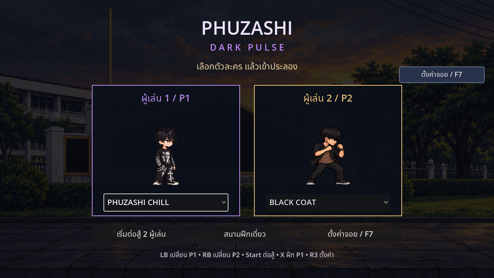

# PHUZASHI — DARK PULSE

เกมต่อสู้ 2D สำหรับ Godot 4.2.2 ขึ้นไป เล่นสองคนด้วยคีย์บอร์ดหรือจอย ตั้งจอยและปุ่มแยกแต่ละฝั่งได้ มีสนามโรงเรียนและสนามฝึกภูเขา

[ดาวน์โหลดโปรเจกต์ Godot รุ่นล่าสุด (.zip)](https://github.com/poohkk567-sys/game/archive/refs/heads/codex/blood-pact-source.zip) · [วิธีเล่น/ปุ่มทั้งหมด](docs/BLOOD_PACT_CHILL_TH.md) · [ผลทดสอบ](docs/BLOOD_PACT_CHILL_TEST_REPORT.md)

แตก ZIP ทั้งหมด → เปิด Godot 4.2.2+ → Import `project.godot` → Import & Edit → รอนำเข้าครั้งแรก → F5 ไม่มี EXE ใหม่ ไม่มีแคชหรือ ZIP รุ่นเก่าซ้อนในชุดดาวน์โหลด

## ตัวละครที่เลือกเล่นได้

| ตัวละคร | รุ่นนี้ |
|---|---|
| PHUZASHI | โมเดลเดิมและสกิลเดิม ครบ6ท่า |
| PHUZASHI CHILL | ตัวใหม่แยก ใช้โมเดลใหม่ครบทุกท่า ยืน/เดิน/ต่อยสามจังหวะชิล มืออีกข้างล้วงกระเป๋า หมัดสามพลังม่วง สกิลและค่าต่อสู้เหมือน PHUZASHI ทุกอย่าง ฟีโน่ใช้คนขับใหม่และหญิงซ้อนท้าย |
| ASSJIRO | แปลงด้วยซีอิ๊วดำ 70 MP ร่างหัวโล้นถึกขึ้น30% สกิลฟรีแต่มีคูลดาวน์ เพิ่มองค์พระ/วงแสงส้มทอง |
| MUAY THAI | ตัวสูงกว่า เน้นศอก/เข่า มีสแตนด์กอริลล่าขนน้ำตาล6สกิล |
| BLACK COAT | เสื้อคลุมดำ เสื้อด้านในน้ำตาล ท่าปกติครบ + อัลติคนอ้วนเปิดประตูมาฟันตัวเอง แลกเลือดกับพลังปีศาจยิ้มแดง |



## สิ่งที่เพิ่ม

- PHUZASHI CHILL มีภาพเต็มตัวใหม่128เฟรม ครบท่าพื้นฐาน คอมโบ ท่าออกสกิล และฟีโน่ใหม่อีก16เฟรม พร้อมคัตอินอัลติของตัวเอง
- BLACK COAT มีท่าพื้นฐาน112เฟรม อัลติใช้70MP ลดเลือด20HPใน5วินาที หยุดที่1HP บัฟโจมตีแรงขึ้น30%นาน10วินาที คูลดาวน์18วินาที ไม่ซ้อน ไม่อมตะ ขัดจังหวะก่อนฟันได้
- PHUZASHI ทั้งสองแบบได้บัฟเชียร์แล้วมีปีศาจม่วงคลุมตัว ล็อคขามีโซ่/วงอักขระเพิ่มและล็อค1.1วินาทีแทน0.7 บัฟหมดกลับปกติ
- ASSJIRO มีออร่าส้มทองระหว่างแปลงและร่างหัวโล้น ซ่อนระหว่างพายุแครอทแล้วกลับมาหลังจบท่า ค่าสถานะเดิม
- คงการดันตัวเมื่อเดินชน แรงถอย/สั่นตามน้ำหนักท่า ทุกยกเริ่ม50/100MP ชาร์จ7MP/s และ PHUZASHI Blink5MP
- [ตัวเสื้อแทร็กดำ–ทอง](docs/concepts/track_jacket_neutral.png) เป็นแบบยืนเท่านั้น สูงระดับASSJIRO156px ยังไม่ทำท่า/สกิลหรือเพิ่มเป็นตัวเล่นตามคำขอ

[วิดีโอในเกม 13 วินาที](https://github.com/poohkk567-sys/game/blob/codex/blood-pact-auras/docs/PHUZASHI_Chill_Preview.mp4?raw=true) — วิดีโอเติม100MPเฉพาะสาธิต การเล่นจริงเริ่ม50MP

## ปุ่มเริ่มเล่น

| คำสั่ง | P1 | P2 | จอยค่าเริ่มต้น |
|---|---|---|---|
| เดิน / วิ่ง | A,D / Shift | ลูกศร / Ctrl | สติ๊กซ้าย,D-pad / RB |
| กระโดด / หมอบ | Space,W / S | ขึ้น / ลง | A / ลง |
| ต่อย / เตะ / กัน | J / K / L | Num1,2,3 หรือ , . / | X / B / LB |
| ชาร์จ / แดช | Q / E | P / Num0 หรือ \ | LT / L3 |
| สกิลหลัก | U | Num4 หรือ ' | RT |
| สกิลนั่งอีก4ท่า | S+J,K,L,Shift | ลง+Num1,2,3,Ctrl | ลง+X,B,LB,RB |
| อัลติ | I; ASSJIRO ใช้ O | Num5 หรือ ; | Y |

ลง+ปุ่มเตะตรงกับ **S+K / เชียร์ PHUZASHI** ค่าเริ่มต้นลง+B หลังตั้งปุ่มเอง สกิลนั่งตามปุ่มต่อย/เตะ/กัน/วิ่งที่เลือกไว้ [รายละเอียดแก้จอย](docs/CONTROLLER_PARITY_TH.md)

คอมโบกดต่อย3ครั้งหรือเตะ3ครั้ง กระโดดแล้วต่อย/เตะได้ กันกดค้างใช้เกจ100และมี Perfect Guard

F1 รายการท่า · F7/R3 ตั้งจอย/ปุ่ม · F8 หน้าแรก · Esc/Start พัก · R เริ่มใหม่ · Tab สลับตัวในสนามฝึก

## โครงสร้างและการทดสอบ

`assets/characters/` ตัวละคร/เฟรม · `assets/effects/` เอฟเฟกต์ · `scenes/` ฉาก · `scripts/character/` การเคลื่อนไหว/แอนิเมชัน · `scripts/combat/` สกิล/สถานะ/แรงปะทะ · `scripts/ui/` เมนู/HUD · `tests/` ตรวจระบบ/ภาพ · `tools/` นำเข้าภาพ/บันทึก/แพ็กโปรเจกต์

```sh
bash tools/check.sh
# หรือเลือก binary:
GODOT_BIN=/path/to/godot bash tools/check.sh
# ตรวจภาพจริง ต้องมี display/OpenGL:
godot --path . --fixed-fps 60 --script tests/test_roster_render.gd
```

ทดสอบทั้ง Godot4.2.2 และ4.6.3 ดูจำนวนและขอบเขตใน [รายงานล่าสุด](docs/BLOOD_PACT_CHILL_TEST_REPORT.md) สร้าง binary SpriteFrames ด้วย **Godot4.2.2** เพื่อรักษารุ่นขั้นต่ำ ผู้เล่นใช้ resource ที่รวมมาแล้วได้ทันที ไม่ต้องสร้างใหม่

ประวัติงานก่อน: [โครงสร้าง/ภูเขา](docs/IMPLEMENTATION.md) · [ปุ่มนั่ง/ดันตัว/แรงปะทะ/ฟีโน่คู่](docs/CONTACT_UPDATE_TH.md) · [หกสกิลเดิม](docs/SIX_SKILLS_TH.md)
