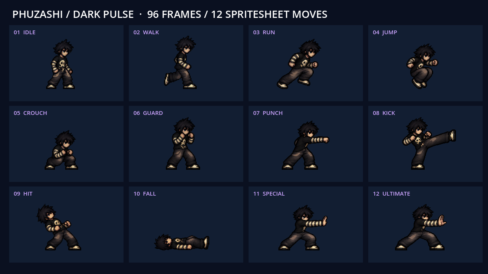

# PHUZASHI — DARK PULSE

เกมต่อสู้ 2D มุมมองด้านข้าง ฉากฝึกตัวละคร PHUZASHI ตัวเดียว สำหรับ Godot **4.2.2+** รุ่นปัจจุบันใช้ **spritesheet ครบ 12 ท่า รวม 96 เฟรม** เป็นภาพเต็มตัวทุกเฟรม



[ชมวิดีโอทุกท่าจากเกมจริง](docs/PHUZASHI_All_Moves.mp4)

## เปิดเล่น

1. เปิด Godot → Import → เลือก `project.godot`
2. กด **F5** เล่น หรือเปิด `scenes/main.tscn` แล้วกด **F6**
3. กด **F2** สาธิตครบทุกท่า หรือ **F1** ดูรายการปุ่ม

```sh
godot --path .
```

## ท่าทั้งหมด

เพิ่มใหม่ **80 เฟรมใน 5 แผ่น** ต่อจากยืน–เดิน 16 เฟรมที่ผู้ใช้เลือก รูปลักษณ์อ้างอิงตัวละครชุดเดียวกัน ไม่มีตัวละครที่สอง

| ท่า | เฟรม | การเล่น | ภาพต้นทาง |
| --- | --- | --- | --- |
| IDLE / WALK | 8 + 8 | วนรอบ | [ยืน–เดิน](assets/characters/drafts/idle_walk_draft.png) |
| RUN / JUMP | 8 + 8 | วิ่งวนรอบ / กระโดดตามฟิสิกส์ | [เคลื่อนไหว](assets/characters/spritesheets/mobility.png) |
| CROUCH / GUARD | 8 + 8 | เข้าท่าแล้วค้างเฟรมสุดท้าย | [หมอบ–ป้องกัน](assets/characters/spritesheets/defense.png) |
| PUNCH / KICK | 8 + 8 | เตรียม–สัมผัส–คืนท่า | [ต่อย–เตะ](assets/characters/spritesheets/strikes.png) |
| HIT / FALL | 8 + 8 | โดนโจมตี / ล้ม–นอน–ลุก | [รับแรงโจมตี](assets/characters/spritesheets/reactions.png) |
| SPECIAL / ULTIMATE | 8 + 8 | ชาร์จ–ปล่อยพลัง–คืนท่า | [สกิล–อัลติเมต](assets/characters/spritesheets/powers.png) |

ใช้ `AnimatedSprite2D` กับ `SpriteFrames` ทั้ง 12 สถานะ ไม่มีการดัดข้อต่อหรือ mesh กับภาพชุดใหม่ เอฟเฟกต์กระสุน โล่ และมังกรแสดงแยกจากตัวละคร เฟรมโจมตีสัมพันธ์กับช่วงสร้างความเสียหายจริง

## ปุ่มควบคุม

| ปุ่ม | การทำงาน |
| --- | --- |
| A / D หรือ ← / → | เดินและหันตามทิศทาง |
| Shift + ทิศทาง | วิ่ง |
| Space | กระโดดและควบคุมทิศทางกลางอากาศ |
| S / ↓ ค้าง | หมอบ ลดขนาด collider |
| L ค้าง | ป้องกัน; ทดลองด้วย H / N |
| J / K | ต่อย 8 damage / เตะ 14 damage |
| U | Dark Pulse — 25 MP, กระสุนเดินทาง, 24 damage |
| I | Ultimate — 60 MP, มังกรพลังม่วง, 60 damage |
| H / N | ทดลองโดนโจมตี 8 HP / ล้ม 18 HP แล้วลุกอัตโนมัติ |
| R | รีเซ็ตตำแหน่ง HP, MP, เป้า และกระสุน |
| F1 / F2 | รายการท่า / สาธิตครบ 12 ท่า |
| F3 / F4 | แสดง hitbox / เทียบกับแอนิเมชันจาก Master เดิม |
| Esc | หยุด / เล่นต่อ |

เข้าใกล้คริสตัลด้านขวาเพื่อต่อยและเตะ สกิลยิงได้จากระยะไกล MP ฟื้น 9 หน่วย/วินาที การโจมตีมีช่วงเตรียม/ออกท่า/คืนท่า และสร้างความเสียหายหนึ่งครั้งต่อท่าต่อเป้า การป้องกันลดความเสียหายจาก H / N เหลือ 2 HP

## การจัดเฟรมและไฟล์ต้นฉบับ

ภาพ PNG ต้นทางมีท่าที่ยื่นพ้นกริดปกติ จึงตัดตามตัวละครที่ต่อเนื่องกันจริง ไม่แบ่งภาพเป็นช่องเท่ากันจนมือหรือเท้าขาด `AtlasTexture` ใช้ canvas ร่วม 512×384 และ pivot (256,360) เท้าทุกเฟรมอยู่ระดับเดียวกัน ใช้สเกลเดียวตลอดชุด

เฟรมล้มสองเฟรมมีกรอบภาพซ้อนกับตัวข้าง ๆ ตัวนำเข้าแยกเฉพาะพิกเซลของตัวที่ถูกต้องแบบ lossless และเก็บเป็น texture ใน resource ส่วนภาพ PNG ต้นทางยังคงเดิม ข้อมูลเฟรมทั้งหมดอยู่ใน [manifest.json](assets/characters/spritesheets/manifest.json)

Master เดิม `assets/characters/PHUZASHI_MASTER_SHOES_APPROVED.png` คงเดิมทุกไบต์:

```text
SHA-256 d0d6156d5114d612c1d04e39781fcd5c783eb09b0ba1268fc8b42c9779e6be06
```

ภาพแอนิเมชันชุดใหม่เป็นภาพเต็มตัวที่สร้างต่อจากชุดยืน–เดินที่ผู้ใช้เลือก ไม่ใช่การคัดลอก Master เฟรมเดียวซ้ำให้เป็นทุกท่า

## โครงสร้าง

```text
assets/characters/              Master และชุดยืน–เดินเดิม
assets/characters/spritesheets/ แผ่นใหม่, manifest และ SpriteFrames
scenes/                        ฉากฝึกและฉากตัวละคร
scripts/character/             Input, movement, combat, animation และ projectile
scripts/stage/                 ฉากภูเขา คริสตัล และโหมดสาธิต
scripts/ui/                    HUD, รายการท่า และ pause overlay
tests/                         ตรวจระบบเกม เฟรมภาพ และบันทึกสาธิต
tools/                         ตัวนำเข้า spritesheet และคำสั่งทดสอบ
docs/                          รายงาน ภาพ และวิดีโอ
browser/                       HTML ต้นแบบเก่า เก็บไว้อ้างอิง
```

## ทดสอบและสร้าง resource ใหม่

```sh
tools/check.sh
# หรือระบุ binary:
GODOT_BIN=/path/to/godot tools/check.sh
```

ทดสอบบน Godot 4.2.2 และ 4.6.3: ระบบเกม 88 รายการ + ระบบ spritesheet 75 รายการ รวม **163 รายการต่อเวอร์ชัน** และภาพเรนเดอร์ **192 เฟรมต่อเวอร์ชัน** มี CI ตรวจซ้ำ ดู [รายงาน](docs/TEST_REPORT.md) และ [รายละเอียดระบบ](docs/IMPLEMENTATION.md)

การสร้าง `phuzashi_frames.res` ใหม่ใช้ **Godot 4.2.2** เพื่อให้ binary resource อ่านได้ตั้งแต่เวอร์ชันขั้นต่ำขึ้นไป:

```sh
/path/to/godot-4.2.2 --headless --path . --editor --import --quit
/path/to/godot-4.2.2 --headless --path . --script tools/import_spritesheets.gd
```

ผู้เล่นเปิดเกมได้ทันทีจาก resource ที่รวมมาแล้ว ขั้นตอนนำเข้าใหม่นี้ใช้เมื่อเปลี่ยนภาพต้นทาง
