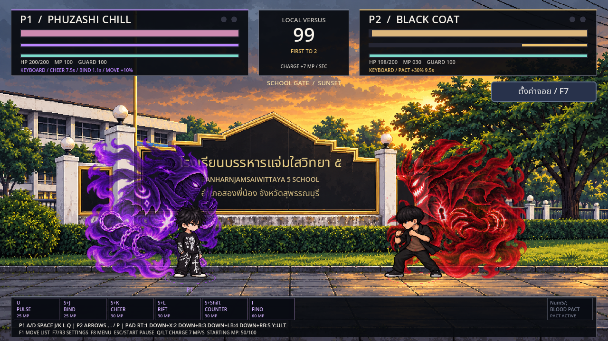

# PHUZASHI — DARK PULSE

เกมต่อสู้ 2D สำหรับ Godot 4.2.2 ขึ้นไป เล่นสองคนด้วยคีย์บอร์ดหรือจอย ตั้งจอยและปุ่มแยกแต่ละฝั่งได้ มีสนามโรงเรียนและสนามฝึกภูเขา

[ดาวน์โหลดโปรเจกต์ Godot รุ่นล่าสุด (.zip)](https://github.com/poohkk567-sys/game/archive/refs/heads/codex/black-six-source.zip) · [สกิล BLACK / ปุ่ม](docs/BLACK_SIX_SKILLS_TH.md) · [ผลทดสอบ](docs/BLACK_SIX_TEST_REPORT.md)

แตก ZIP ทั้งหมด → เปิด Godot 4.2.2+ → Import `project.godot` → Import & Edit → รอนำเข้าครั้งแรก → F5 ไม่มี EXE ใหม่ ไม่มีแคชหรือ ZIP รุ่นเก่าซ้อนในชุดดาวน์โหลด

## ล่าสุด: BLACK ครบ 6 สกิลแดง

คลื่นเขี้ยวแดง U/RT · พุ่งอัดสามจังหวะ S+J/ลง+X · หมัดเสย S+K/ลง+B · เขี้ยวขยี้การ์ด S+L/ลง+LB · ระเบิดโทสะ S+Shift/ลง+RB · อัลติสัญญาเลือด I/Y เดิม เอฟเฟกต์ปีศาจยิ้มแดงชุดใหม่20ภาพ และท่าหมัดเสย/ทุบเต็มตัว16ภาพ ทุกสกิลโจมตีรับบัฟตีแรง30%จากอัลติได้ เล่นได้ทั้งสองฝั่งและสนามฝึก

[ตารางมานา/คูลดาวน์/กติกาและภาพจริง](docs/BLACK_SIX_SKILLS_TH.md) · [วิดีโอ Godot](https://github.com/poohkk567-sys/game/blob/codex/black-six-red-skills/docs/PHUZASHI_Black_Six_Preview.mp4?raw=true) · [ผลทดสอบ](docs/BLACK_SIX_TEST_REPORT.md)

## สแตนด์แดชฟรี / ประสานอินวาร์ปกลับ / ผลักก่อนแปลง

- PHUZASHIทั้งสองโมเดลแดชฟรีและไม่มีคูลดาวน์ระหว่างบัฟสแตนด์ กดเตรียมแดชต่อเนื่องได้แม้มานา0 บัฟหมดกลับ5MPเดิม
- หลุมใต้พื้นเปลี่ยนเป็นShadow Return กดS+L/จอยลง+LB ต้องปาดาวกระจายโดนก่อน รวมโดนการ์ดและPerfect Guard ได้สิทธิ์1ครั้ง ประสานอิน→วาร์ปหลัง→โจมตี→กลับจุดเริ่ม30MP/26ดาเมจ
- ASSJIROร่างหมวกใช้ช่องปาขวดเป็นผลักสองฝ่ามือ30MP/10ดาเมจ ส่งคู่ต่อสู้กระเด็นออกไกล หลังแปลงเป็นปาขวดฟรีเดิม ใช้คูลดาวน์ร่วมกัน7วินาที

[รายละเอียดและภาพ/วิดีโอ](docs/SHADOW_RETURN_TH.md) · [ผลทดสอบ](docs/SHADOW_RETURN_TEST_REPORT.md)

## นินจายืนตัวเล็กและโซ่รัดตัว

แก้ปีศาจท่าล็อคที่ถูกคู่ต่อสู้บังเป็นนินจาตัวเล็กยืนดึงโซ่ภาพใหม่8เฟรม ยืนแยกออกมาด้านหลัง มีโซ่รัดหน้าอก/เอว/สะโพกและไขว้ลำตัว โซ่และนินจามีลำดับการวาดแยกจึงไม่ถูกทับหาย คงขนาด100/116px มานา25 และล็อค0.7/1.1วินาที

[รายละเอียดและภาพในเกม](docs/STANDING_BIND_TH.md) · [ผลทดสอบ](docs/STANDING_BIND_TEST_REPORT.md)

## เชียร์ ดาวกระจาย พระ และฟีโน่

เชียร์จบและผู้หญิงหายก่อนจึงได้บัฟ8วินาที/ปีศาจโผล่ในควัน นินจาท่าล็อคเป็นร่างเล็กท่ายืนดึงโซ่ต่างจากสแตนด์ ลูกไฟเปลี่ยนเป็นดาวกระจายม่วงหมุน ฟีโน่ชนแล้วชะลอรถส่งอีกฝั่งลอยกระเด็น พระASSJIROลอยลงจากฟ้าตอนถอดเสื้อ คงปุ่ม/มานา/ดาเมจและกติกาเดิม ยกเว้นจังหวะเริ่มบัฟเชียร์ย้ายไปหลังเธอเชียร์เสร็จตามที่เลือก

[รายละเอียดและวิดีโอรุ่นนี้](docs/NINJA_ARRIVALS_TH.md) · [ผลทดสอบ](docs/NINJA_ARRIVALS_TEST_REPORT.md)

## ออร่าหันข้างลายเส้นพิกเซล

- **PHU:** ปีศาจนินจาม่วง Shadow Shinobi มีหน้ากาก ผ้าควันและโซ่เงา ใช้ตอนบัฟเชียร์และฟีโน่ ท่าล็อคใช้ร่างเล็กท่าเกาะแยก
- **BLACK:** Crimson Grin ปีศาจแดงยิ้มเสี้ยวจันทร์ เขาต่างทรง ปกเสื้อควัน และตรารูกุญแจ หลังอัลติฟันแลกเลือด
- **ASSJIRO:** Golden Lotus องค์พระหันข้าง วงแสงบัวและเปลวพลังส้มทองระหว่างแปลง/ร่างหัวโล้น

ทั้งสามเคลื่อนไหว8เฟรมต่อตัว หันตามทิศ อยู่ด้านหลังนักสู้ ค่าสกิล/บัฟ/มานาเดิมทั้งหมด ใช้แบบพิกเซลที่เลือก ไม่ใช่ภาพอนิเมะทดลอง

[รายละเอียดออร่าใหม่](docs/SIDE_GUARDIANS_TH.md) · [ผลทดสอบรุ่นนี้](docs/SIDE_GUARDIANS_TEST_REPORT.md)



## ตัวละครที่เลือกเล่นได้

| ตัวละคร | รุ่นนี้ |
|---|---|
| PHUZASHI | โมเดลเดิมและสกิลเดิม ครบ6ท่า |
| PHUZASHI CHILL | ตัวใหม่แยก ใช้โมเดลใหม่ครบทุกท่า ยืน/เดิน/ต่อยสามจังหวะชิล มืออีกข้างล้วงกระเป๋า หมัดสามพลังม่วง สกิลและค่าต่อสู้เหมือน PHUZASHI ทุกอย่าง ฟีโน่ใช้คนขับใหม่และหญิงซ้อนท้าย |
| ASSJIRO | แปลงด้วยซีอิ๊วดำ 70 MP ร่างหัวโล้นถึกขึ้น30% สกิลฟรีแต่มีคูลดาวน์ เพิ่มองค์พระ/วงแสงส้มทอง |
| MUAY THAI | ตัวสูงกว่า เน้นศอก/เข่า มีสแตนด์กอริลล่าขนน้ำตาล6สกิล |
| BLACK COAT | เสื้อคลุมดำ เสื้อด้านในน้ำตาล ท่าปกติครบ + 6 สกิลปีศาจแดง สายบุกประชิด อัลติคนอ้วนเปิดประตูฟันตัวเองแลกเลือดกับพลัง |


## สิ่งที่เพิ่ม

- PHUZASHI CHILL มีภาพเต็มตัวใหม่128เฟรม ครบท่าพื้นฐาน คอมโบ ท่าออกสกิล และฟีโน่ใหม่อีก16เฟรม พร้อมคัตอินอัลติของตัวเอง
- BLACK COAT มีท่าพื้นฐาน112เฟรม สกิลโจมตีแดง5ท่ากับอัลติสัญญาเลือด อัลติใช้70MP ลดเลือด20HPใน5วินาที หยุดที่1HP บัฟโจมตีแรงขึ้น30%นาน10วินาที คูลดาวน์18วินาที ไม่ซ้อน ไม่อมตะ ขัดจังหวะก่อนฟันได้
- PHUZASHI ทั้งสองแบบได้บัฟเชียร์แล้วมีปีศาจม่วงคลุมตัว ล็อคขามีโซ่/วงอักขระเพิ่มและล็อค1.1วินาทีแทน0.7 บัฟหมดกลับปกติ
- ASSJIRO มีออร่าส้มทองระหว่างแปลงและร่างหัวโล้น ซ่อนระหว่างพายุแครอทแล้วกลับมาหลังจบท่า ค่าสถานะเดิม
- คงการดันตัวเมื่อเดินชน แรงถอย/สั่นตามน้ำหนักท่า ทุกยกเริ่ม50/100MP ชาร์จ7MP/s และ PHUZASHI Blink5MPปกติ/ฟรีระหว่างบัฟสแตนด์
- [ตัวเสื้อแทร็กดำ–ทอง](docs/concepts/track_jacket_neutral.png) เป็นแบบยืนเท่านั้น สูงระดับASSJIRO156px ยังไม่ทำท่า/สกิลหรือเพิ่มเป็นตัวเล่นตามคำขอ

[วิดีโอในเกม 13 วินาที](https://github.com/poohkk567-sys/game/blob/codex/blood-pact-auras/docs/PHUZASHI_Chill_Preview.mp4?raw=true) — วิดีโอเติม100MPเฉพาะสาธิต การเล่นจริงเริ่ม50MP

## ปุ่มเริ่มเล่น

| คำสั่ง | P1 | P2 | จอยค่าเริ่มต้น |
|---|---|---|---|
| เดิน / วิ่ง | A,D / Shift | ลูกศร / Ctrl | สติ๊กซ้าย,D-pad / RB |
| กระโดด / หมอบ | Space,W / S | ขึ้น / ลง | A / ลง |
| ต่อย / เตะ / กัน | J / K / L | Num1,2,3 หรือ , . / | X / B / LB |
| ชาร์จ / แดช | Q / E | P / Num0 หรือ \ | LT / L3 |
| สกิลหลัก | U | Num4 หรือ ' | RT |
| สกิลนั่งอีก4ท่า | S+J,K,L,Shift | ลง+Num1,2,3,Ctrl | ลง+X,B,LB,RB |
| อัลติ | I; ASSJIRO ใช้ O | Num5 หรือ ; | Y |

ลง+ปุ่มเตะตรงกับ **S+K / เชียร์ PHUZASHI** ค่าเริ่มต้นลง+B หลังตั้งปุ่มเอง สกิลนั่งตามปุ่มต่อย/เตะ/กัน/วิ่งที่เลือกไว้ [รายละเอียดแก้จอย](docs/CONTROLLER_PARITY_TH.md)

คอมโบกดต่อย3ครั้งหรือเตะ3ครั้ง กระโดดแล้วต่อย/เตะได้ กันกดค้างใช้เกจ100และมี Perfect Guard

F1 รายการท่า · F7/R3 ตั้งจอย/ปุ่ม · F8 หน้าแรก · Esc/Start พัก · R เริ่มใหม่ · Tab สลับตัวในสนามฝึก

## โครงสร้างและการทดสอบ

`assets/characters/` ตัวละคร/เฟรม · `assets/effects/` เอฟเฟกต์ · `scenes/` ฉาก · `scripts/character/` การเคลื่อนไหว/แอนิเมชัน · `scripts/combat/` สกิล/สถานะ/แรงปะทะ · `scripts/ui/` เมนู/HUD · `tests/` ตรวจระบบ/ภาพ · `tools/` นำเข้าภาพ/บันทึก/แพ็กโปรเจกต์

```sh
bash tools/check.sh
# หรือเลือก binary:
GODOT_BIN=/path/to/godot bash tools/check.sh
# ตรวจภาพจริง ต้องมี display/OpenGL:
godot --path . --fixed-fps 60 --script tests/test_roster_render.gd
```

ทดสอบทั้ง Godot4.2.2 และ4.6.3 ดูจำนวนและขอบเขตใน [รายงานล่าสุด](docs/BLACK_SIX_TEST_REPORT.md) สร้าง binary SpriteFrames ด้วย **Godot4.2.2** เพื่อรักษารุ่นขั้นต่ำ ผู้เล่นใช้ resource ที่รวมมาแล้วได้ทันที ไม่ต้องสร้างใหม่

ประวัติงานก่อน: [โครงสร้าง/ภูเขา](docs/IMPLEMENTATION.md) · [ปุ่มนั่ง/ดันตัว/แรงปะทะ/ฟีโน่คู่](docs/CONTACT_UPDATE_TH.md) · [หกสกิลเดิม](docs/SIX_SKILLS_TH.md)
