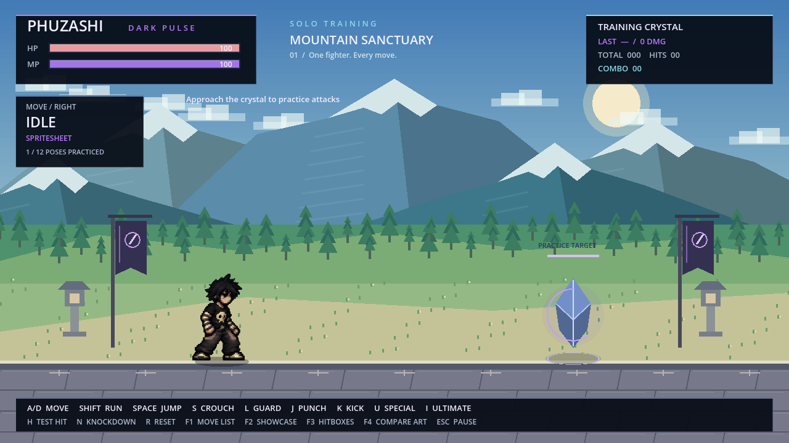
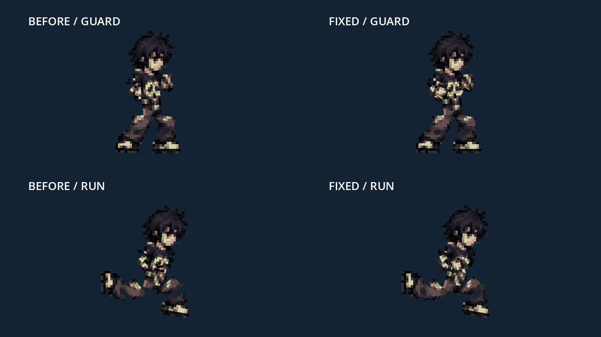

# PHUZASHI — DARK PULSE

ฉากฝึกซ้อมเกมต่อสู้ 2D มุมมองด้านข้าง สำหรับ Godot **4.2.2 ขึ้นไป** มี PHUZASHI ตัวเดียว ใช้ภาพต้นฉบับเดิม พร้อมแอนิเมชันครบ 12 ท่า เป้าคริสตัลวัดความเสียหาย และโหมดสาธิตทุกท่า



**เวอร์ชันทดลองล่าสุด:** ท่ายืนและเดินใช้ `AnimatedSprite2D` จากร่าง spritesheet จริง ท่าละ 8 เฟรม เปิดเกมด้วย F5 แล้วกด **F4** เทียบกับภาพเดิมได้ ท่าอื่นยังใช้ rig เดิม ร่างงานอาร์ตนี้ยังต้องปรับรายละเอียดให้ตรง Master ก่อนทำครบทุกท่า

[ชมวิดีโอทดลอง spritesheet และสลับเทียบภาพเดิม](docs/PHUZASHI_Spritesheet_Trial.mp4)

[ชมวิดีโอสาธิตครบทุกท่าจาก Godot](docs/PHUZASHI_All_Moves.mp4)

## เปิดเล่น

1. เปิด Godot → Import → เลือก `project.godot`
2. กด **F5** เล่นทั้งโปรเจกต์ หรือเปิด `scenes/main.tscn` แล้วกด **F6**
3. กด **F1** ดูรายการท่า หรือ **F2** ชมการสาธิตครบทั้ง 12 ท่า

```sh
godot --path .
```

## ปุ่มควบคุม

| ปุ่ม | การทำงาน |
| --- | --- |
| A / D หรือ ← / → | เดินและหันตามทิศทาง |
| Shift + ทิศทาง | วิ่ง |
| Space | กระโดด; ควบคุมซ้ายขวากลางอากาศ |
| S / ↓ ค้าง | หมอบ ลดขนาด collider |
| L ค้าง | ป้องกัน; ทดลองรับแรงโจมตีด้วย H / N |
| J | ต่อย — 8 damage |
| K | เตะ — 14 damage |
| U | Dark Pulse — 25 MP, กระสุนเดินทางจริง, 24 damage |
| I | Ultimate — 60 MP, มังกรพลังม่วง, 60 damage |
| H | ทดลองโดนโจมตี — 8 HP พร้อม hit-stun |
| N | ทดลองล้ม — 18 HP พร้อมลุกกลับอัตโนมัติ |
| R | รีเซ็ตตำแหน่ง HP, MP, เป้า และกระสุน |
| F1 | เปิด/ปิดรายการท่า |
| F2 | สาธิตครบ 12 ท่าวนซ้ำ; กดปุ่มเล่นเพื่อกลับไปควบคุมเอง |
| F3 | แสดง collider และ hitbox |
| F4 | สลับ spritesheet ยืน/เดินกับภาพ Master เดิม |
| Esc | หยุด/เล่นต่อ |

เข้าใกล้คริสตัลด้านขวาเพื่อลองต่อยและเตะ สกิลยิงได้จากระยะไกล MP ฟื้น 9 หน่วย/วินาที การโจมตีมีช่วงเตรียม/ออกท่า/คืนท่า และสร้างความเสียหายหนึ่งครั้งต่อท่าต่อเป้า การป้องกันลดความเสียหายจาก H / N เหลือ 2 HP

## ตัวละครต้นฉบับและท่าทั้งหมด


**IDLE, WALK, RUN, JUMP, CROUCH, GUARD, PUNCH, KICK, HIT, FALL, SPECIAL, ULTIMATE** มี keyframe timeline แยกกัน ท่ากระโดดใช้ความเร็วแนวตั้งกำหนดช่วงขึ้น/ลง ส่วน FALL เป็นท่าล้มและลุก ไม่ใช่สถานะตกกลางอากาศ

สำหรับท่าอื่นที่ยังไม่มี spritesheet: ต้นฉบับใน Repository มีภาพโปร่งใส **64×64 เพียงเฟรมเดียว** จึงใช้ rig 10 ข้อต่อขับ **mesh ต่อเนื่องที่ใช้ texture ต้นฉบับ** ขอบภาพตรงข้อต่อใช้จุดร่วมกันและผสมน้ำหนักเฉพาะบริเวณข้อต่อ เพื่อไม่ให้ภาพขาดเมื่อแขนขาหมุน ใบหน้า/ผมและรองเท้าเคลื่อนเป็นส่วนแข็งโดยไม่ยืดรูป ไม่วาดดีไซน์ใหม่หรือเปลี่ยนสี เอฟเฟกต์พลังแสดงแยกจากตัวละคร นี่เป็นแอนิเมชันจากภาพเดิม ไม่ใช่ sprite sheet ที่วาดใหม่ทุกเฟรมตามภาพตัวอย่าง



ไฟล์ `assets/characters/PHUZASHI_MASTER_SHOES_APPROVED.png` คงเดิมทุกไบต์:

```text
SHA-256 d0d6156d5114d612c1d04e39781fcd5c783eb09b0ba1268fc8b42c9779e6be06
```

ระบบตรวจสอบว่าทุกพิกเซลที่มองเห็นถูกกำหนดให้ข้อต่อเดียว และประกอบชิ้นส่วนกลับเป็นต้นฉบับได้พอดี ไม่มีตัวละครที่สอง เป้าคริสตัลเป็นวัตถุฝึกที่ไม่เคลื่อนที่หรือโจมตีกลับ

## โครงสร้าง

```text
assets/characters/    ภาพ Master, ร่าง spritesheet และ SpriteFrames
scenes/              ฉากฝึกและฉาก PHUZASHI
scripts/character/   Input, movement/state, rig, combat และ projectile
scripts/stage/       ภูเขา/ฉาก, คริสตัล และโหมดสาธิต
scripts/ui/          HUD, รายการท่า และ pause overlay
tests/               Godot integration tests และการบันทึกภาพ/วิดีโอ
tools/check.sh       ตรวจ import, runtime errors และ gameplay
docs/                ผลทดสอบ ภาพ และรายละเอียดการออกแบบ
browser/             HTML ต้นแบบเดิม เก็บไว้อ้างอิง
```

เกมที่พัฒนารอบนี้อยู่ใน **Godot** ส่วน `browser/PHUZASHI_Playable_Demo.html` เป็นต้นแบบเก่าที่เก็บรักษาไว้และมีระบบการเล่นคนละรุ่น

## ทดสอบ

```sh
tools/check.sh
# หรือระบุ Godot binary
GODOT_BIN=/path/to/godot tools/check.sh
```

ทดสอบด้วย physics server จริง ตรวจ movement, jump/landing, facing, arena bounds, crouch/guard, hit windows, damage, MP, projectile lifecycle, hit/fall recovery, pause, reset, ความคงเดิมของพิกเซล การเชื่อม mesh และโหมดสาธิตครบ 12 สถานะ เพิ่มการทดสอบภาพเรนเดอร์ 216 ภาพสำหรับป้องกันแขนขาขาดจากตัว มี CI บน Godot 4.2.2 และ 4.6.3

ดู [รายงานการทดสอบ](docs/TEST_REPORT.md) และ [รายละเอียดระบบ](docs/IMPLEMENTATION.md)

## การนำ spritesheet ร่างมาใช้จริง

ภาพร่าง 2172×724 ถูกคัดลอกโดยไม่แก้พิกเซลไปไว้ที่ `assets/characters/drafts/idle_walk_draft.png` ตัวนำเข้าหาขอบตัวละครจาก alpha ≥ 0.5 แล้วสร้าง `AtlasTexture` 16 เฟรมใน canvas ร่วม 320×362 พร้อม pivot (160,340) ตั้งเท้าและเอวตรงกัน โดยไม่ยืดหรือดัดแต่ละส่วนของภาพ

- IDLE: 8 เฟรม / 6 FPS; WALK: 8 เฟรม / 11 FPS
- ใช้สเกลเดียวกันทุกเฟรม ตัวละครสูงสุด 156 px ในฉาก
- Shader ตัด alpha จางที่เป็นเศษรอบภาพ โดยไม่แก้ PNG ต้นฉบับ
- เปิดใช้ในฉากตัวละครเป็นค่าเริ่มต้นสำหรับ IDLE/WALK และกด F4 สลับเทียบได้
- Master PNG ยังคงเดิมทุกไบต์; การทดลองร่างนี้ไม่ถือเป็นการรับรองว่ารายละเอียดทุกเฟรมตรงกับ Master แล้ว

สร้าง resource ใหม่หลังเปลี่ยนภาพร่างด้วย:

```sh
godot --headless --path . --editor --import --quit
godot --headless --path . --script tools/import_draft_spritesheet.gd
```
