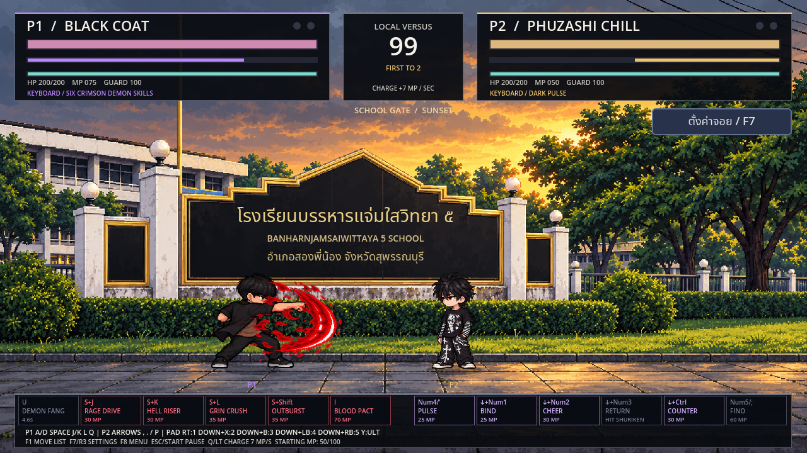
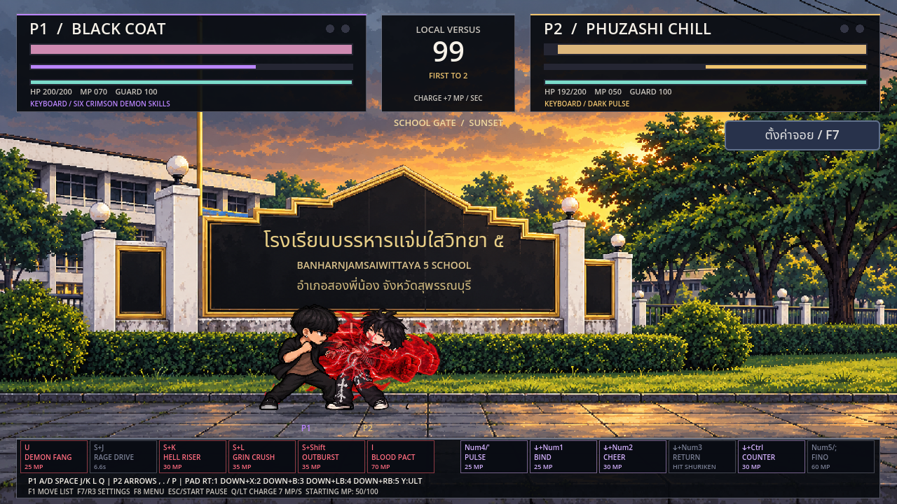
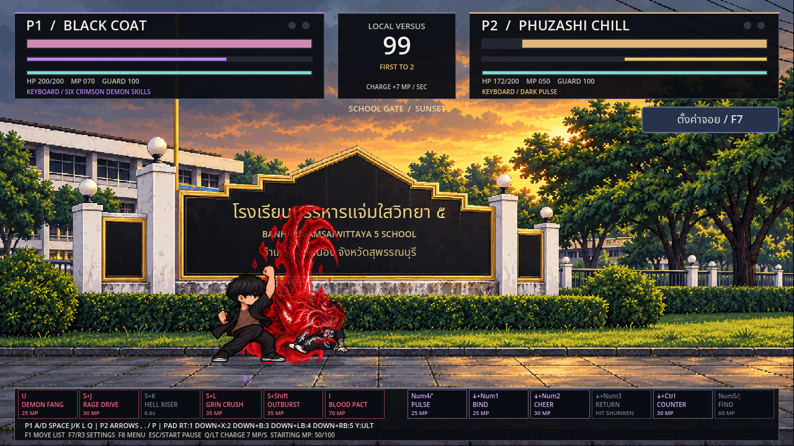
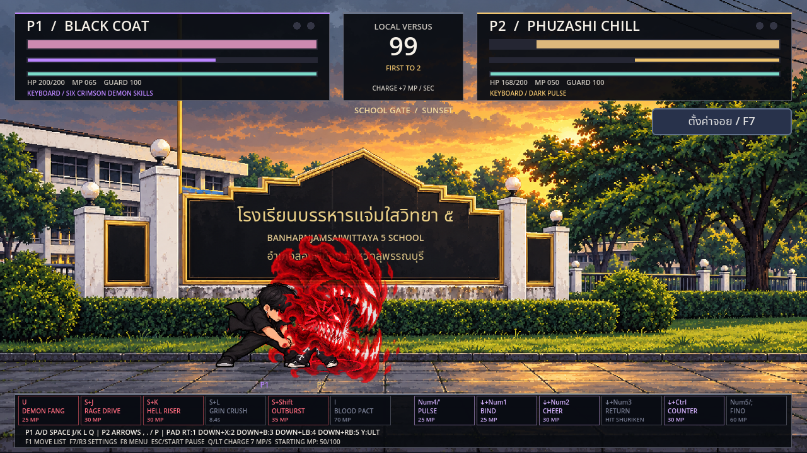
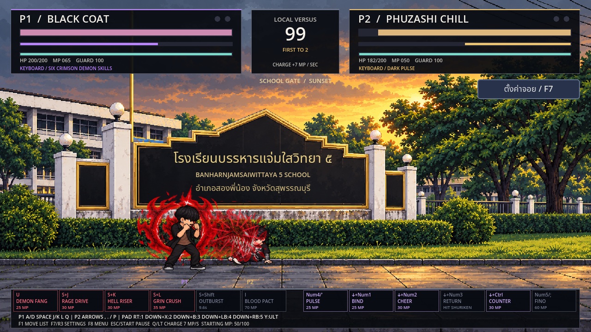
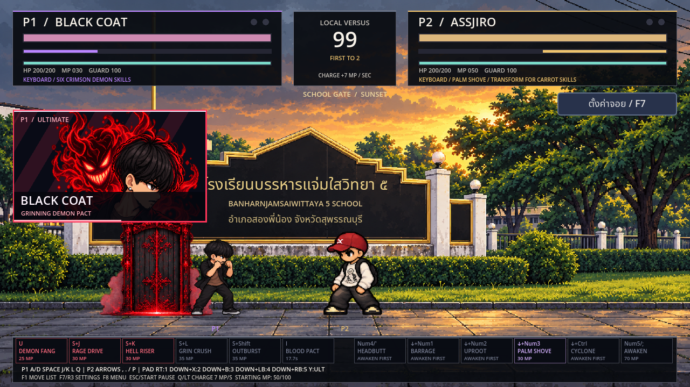

# BLACK COAT — Crimson Temper

BLACK มีสกิลครบ **6 ท่า** รวมอัลติเดิม บุคลิกอารมณ์ร้อน บุกประชิดด้วยหมัดและปีศาจยิ้ม Crimson Grin เอฟเฟกต์สกิลเป็นสีแดงเข้ม/แดงเพลิง/แสงแดงขาวทุกท่า ตัวละครยังใส่เสื้อคลุมดำกับเสื้อข้างในน้ำตาลเหมือนเดิม

## ปุ่มและค่าท่า

| ท่า | P1 | จอยค่าเริ่มต้น | MP | ดาเมจปกติ | คูลดาวน์ | ผลเมื่อโดน |
|---|---|---|---:|---:|---:|---|
| Crimson Demon Fang / คลื่นเขี้ยวแดง | U | RT / R2 | 25 | 22 | 5 วิ | คลื่นปีศาจพุ่งแนวนอน ระยะเดินทาง 560px โดนได้ครั้งเดียว |
| Rage Drive / พุ่งอัดโทสะ | S+J | ลง+X / ลง+สี่เหลี่ยม | 30 | 8+8+14 = 30 | 7 วิ | วิ่งกดดัน ต่อย 3 จังหวะ หมัดสุดท้ายส่งกระเด็น |
| Hell Riser / หมัดเสยอเวจี | S+K | ลง+B / ลง+วงกลม | 30 | 28 | 7 วิ | กรงเล็บเพลิงไล่ขึ้น ส่งตัวคู่แข่งลอยตีลังกา |
| Grin Crush / เขี้ยวขยี้การ์ด | S+L | ลง+LB / ลง+L1 | 35 | 32 | 9 วิ | ทุบสองมือพร้อมเขี้ยวปีศาจ ลงพื้นล้ม; ถ้ากันลดเกจการ์ด 40 |
| Crimson Outburst / ระเบิดโทสะ | S+Shift | ลง+RB / ลง+R1 | 35 | 18 | 10 วิ | ระเบิดปีศาจยิ้มรอบตัว ผลักคู่ต่อสู้ออกทั้งด้านหน้าและหลัง |
| Grinning Demon Pact / สัญญาเลือด | I | Y / สามเหลี่ยม | 70 | บัฟ | 18 วิ | คนอ้วนเปิดประตูฟันเจ้าตัว เสียเลือดแล้วเพิ่มพลังโจมตีตามเดิม |

P2 ช่อง 1–6 ตามลำดับ: **Num4 หรือ ' / ลง+Num1 / ลง+Num2 / ลง+Num3 / ลง+Ctrl / Num5 หรือ ;** ใช้ `, . /` แทน Num1/2/3 ได้ จอยทั้งสองฝั่งใช้ชุดเดียวกัน แต่ละท่าเป็นคำสั่งของผู้เล่นคนนั้น หากตั้งปุ่มใหม่ สกิลนั่งยังตามคำสั่งต่อย/เตะ/ป้องกัน/วิ่งที่ตั้งไว้

กดนั่งค้างก่อนแล้วกดปุ่มท่า ไม่มีการเปลี่ยนปุ่ม U/RT หรืออัลติ การกดค้างไม่รัวสกิลอัตโนมัติ

## จังหวะเล่น

คลื่นเขี้ยวใช้เปิดทางและกดดันจากกลางจอ จากนั้นใช้ Rage Drive เข้าไปอัด หมัดเสยใช้ทำให้อีกฝั่งลอย ส่วน Grin Crush มีช่วงเงื้อนานกว่า แลกกับลดการ์ดมาก เมื่อถูกบุกชิด ใช้ Outburst ดันคู่ต่อสู้ออกแล้วตั้งระยะใหม่

ทั้ง 5 ท่าใช้มานาตามตาราง มี startup / active / recovery และขัดจังหวะได้ ไม่มีอมตะพิเศษ แดชยังเป็นแดชกายภาพเดิม ท่าพุ่งใช้ระบบดันตัว จึงไม่วาร์ปหรือเดินผ่านคู่แข่ง คลื่นมีระยะจำกัด ไม่ตามเป้าหมาย และกระโดดหลบได้ สกิลประชิดใช้ระยะชนจริง ไม่มีการดึงตัวฝ่ายตรงข้ามมาติดคอมโบอัตโนมัติ

กันปกติเสียเลือด 2 ต่อการโดนหนึ่งจังหวะ (Rage Drive ครบชุดเป็น 6) Perfect Guard ยังกันได้ 0 และไม่เสียเกจ รวมถึง Grin Crush ซึ่งไม่ใช่ท่าทะลุการ์ด เมื่อเกจไม่พอใช้กติกา guard break เดิม ผลัก/ลอย/สั่นเกิดเฉพาะตามผลการโดนจริง ไม่ส่งคนที่กันสำเร็จลอย

## อัลติเดิมและการต่อสกิล

หลังคนอ้วนฟันโดน BLACK เสียเลือดรวม 20HP ใน 5 วินาที โดยลดตัวเองไม่ต่ำกว่า 1HP แลกกับ **โจมตีแรงขึ้น 30% นาน 10 วินาที** มีปีศาจแดงยิ้มคลุมตัว ไม่ซ้อนบัฟและยังรับการโจมตีได้ ใช้มานา 70 และคงคัตอินหน้าตัวละครด้านซ้าย

สกิลใหม่ได้โบนัสจากบัฟเดียวกันตอนยืนยันการโดน: Fang **29**, Rage Drive **10+10+18 = 38** (ปัดเศษทีละหมัด), Hell Riser **36**, Grin Crush **42**, Outburst **23** การ์ดยังคงเสีย chip 2 ต่อครั้ง บัฟไม่เพิ่มความเสียหายตัวเอง และสกิลโจมตีใหม่ทั้ง 5 ไม่หัก HP เพิ่ม

เริ่มทุกยกที่ **50/100MP** ชาร์จ Q/LT เพิ่ม 7 ต่อวินาที หรือต่อยเตะปกติเข้าเป้าหมายเพื่อเก็บมานาตามเดิม

## ภาพจริงและเปิดเกม

[ดาวน์โหลดโปรเจกต์ Godot](https://github.com/poohkk567-sys/game/archive/refs/heads/codex/black-six-source.zip) · [วิดีโอจาก Godot](https://github.com/poohkk567-sys/game/blob/codex/black-six-red-skills/docs/PHUZASHI_Black_Six_Preview.mp4?raw=true) · [ผลทดสอบ](BLACK_SIX_TEST_REPORT.md)

แตก ZIP → Godot 4.2.2 ขึ้นไป → Import `project.godot` → Import & Edit → รอนำเข้า → F5 เลือก BLACK COAT ได้ทั้ง P1/P2 หรือสนามฝึกเดี่ยว ไม่มี EXE ใหม่

