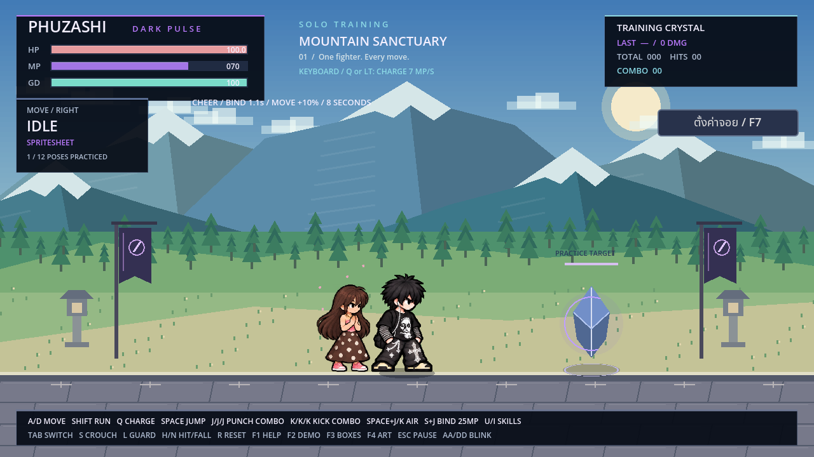
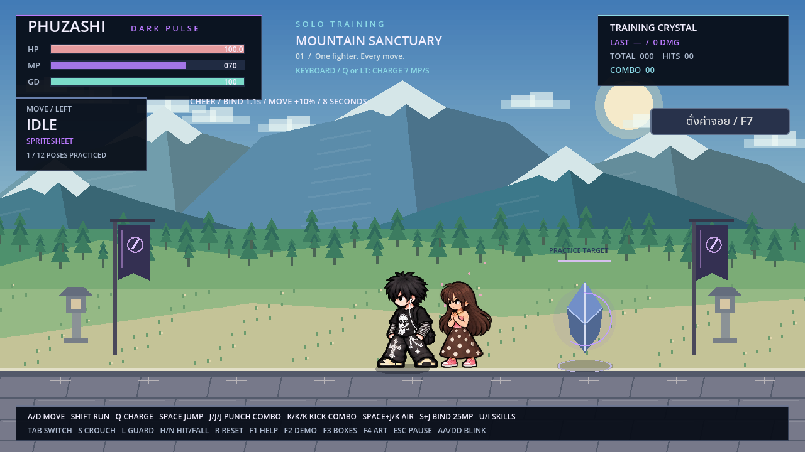

# ตัวช่วยหญิง: ปรับให้เข้ากับ PHUZASHI

ปรับเส้นขอบให้คม ตาเป็นทรงเรียบขาวดำ หน้ามีกรอบชัดขึ้น ลดสัดส่วนหัว เพิ่มความยาวช่วงตัวและแขนขาให้ใกล้ PHUZASHI ในฉากเดียวกัน คงผมยาวสีน้ำตาลและหน้าม้า เสื้อชมพู สร้อยและกำไล กระโปรงน้ำตาลลายจุดขาว และรองเท้าผ้าใบชมพูพื้นขาว

- `assets/characters/phuzashi_clear/cheer_style_reference.png`: โมเดลอ้างอิงใหม่
- `cheer_assist.png`: สไปรต์ชีต 4×4 ท่าวิ่ง 8 เฟรมและเชียร์ 8 เฟรม
- `cheer_assist_frames.res`: AtlasTexture แยกตัวเต็ม กำหนดจุดวางเท้า และกลับด้านได้

ภาพ PNG ต้นทางเก็บไว้ครบทั้งชีต ไม่ตัดชิ้นส่วนร่างกายมาเคลื่อนไหว ความสูงและการวางเท้าในเกมใช้ระบบเดิม บทบาทยังเป็นตัวช่วยวิ่งเข้าเชียร์

## เปิดเล่น

แตก ZIP ทั้งหมด เปิด Godot 4.2.2 ขึ้นไป → Import `project.godot` → Import & Edit → รอนำเข้า → F5 เลือก PHUZASHI แล้วเข้าฝึกหรือสู้สองผู้เล่น กด **T** เรียกตัวช่วย หรือ **[** เมื่อเป็นผู้เล่น 2 จอยใช้ **D-pad ขึ้น** ตามค่าเริ่มต้น

ใช้ 30 MP คูลดาวน์ 14 วินาที เมื่อวิ่งมาถึงได้บัฟ 8 วินาที: ล็อกปีศาจ 0.7 → 1.1 วินาที และเดิน/วิ่งเร็วขึ้น 10% กติกาและเอฟเฟกต์เดิมคงอยู่ รอบนี้เปลี่ยนเฉพาะภาพตัวช่วย

## หลักฐานการตรวจ

ทดสอบด้วย Godot 4.2.2 และ 4.6.3:

- `tests/test_roster_render.gd`: ผ่าน 352 ตัวอย่างต่อเวอร์ชัน รวมตัวช่วย 16 เฟรม × 2 ทิศ ไม่มีตัวหายหรือขอบภาพถูกตัด
- `tests/test_new_rules.gd`: ผ่าน 53 ข้อต่อเวอร์ชัน รวมเรียกเชียร์ ใช้มานา คูลดาวน์ บัฟล็อก/ความเร็ว และหมดบัฟตามเวลา
- บันทึกฉากฝึกจริง หันขวาและหันซ้าย วิ่งเข้า เชียร์ และวิ่งออก ดู [วิดีโอ](PHUZASHI_Cheer_Style.mp4)
- ภาพต้นฉบับ `PHUZASHI_MASTER_SHOES_APPROVED.png` มี SHA-256 เดิม: `d0d6156d5114d612c1d04e39781fcd5c783eb09b0ba1268fc8b42c9779e6be06`

นำเข้า atlas ด้วย Godot 4.2.2 เพื่อให้ไฟล์ `.res` เปิดกับเวอร์ชันขั้นต่ำได้ ใช้ `tools/import_fino_walk.gd` ในโปรเจกต์ชั่วคราวที่มีเพียงชีตตัวช่วย จึงไม่เขียนทับชีตเดินหรือฟีโน่ บันทึกวิดีโอซ้ำได้ด้วย `godot --path . --fixed-fps 60 --write-movie work/cheer_style.avi --script tools/record_cheer_style.gd` หลังสร้างโฟลเดอร์ `work`

ไฟล์ดาวน์โหลดเป็นซอร์ส Godot ไม่มี EXE หรือ PCK ใหม่
