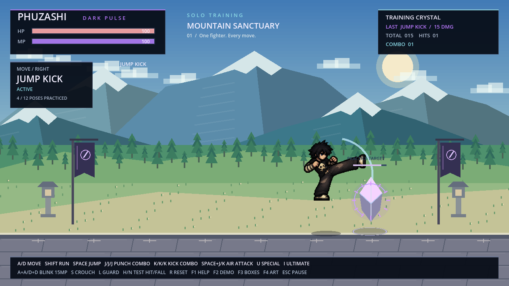
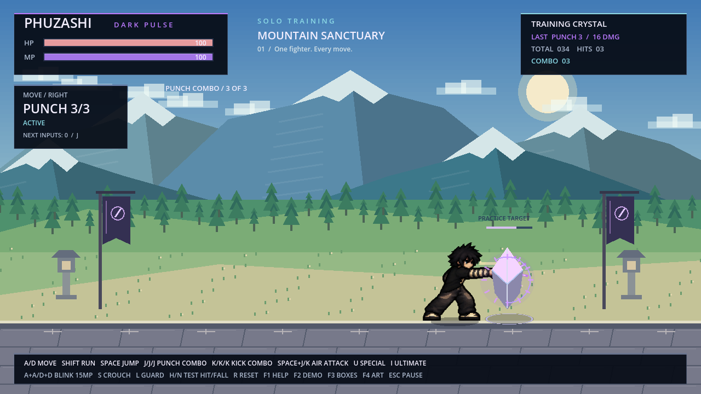

# กระโดดโจมตีและคอมโบ 3 จังหวะ

รุ่นล่าสุดเปลี่ยนหมัดที่ 2–3 และเตะที่ 2–3 เป็นภาพท่าใหม่ พร้อมหมัดม่วงแล้ว ดู [รุ่นท่าใหม่และไฟล์ดาวน์โหลด](DISTINCT_COMBO_POSES_TH.md)

[ดาวน์โหลดเกมทดสอบ Godot ZIP](https://github.com/poohkk567-sys/game/blob/codex/air-attacks-three-hit-combos/docs/downloads/PHUZASHI_Air_Combos_Godot.zip?raw=true)

แตก ZIP → เปิด Godot 4.2.2 ขึ้นไป → Import `project.godot` → กด F5 เล่น

| ปุ่ม | ท่า | ดาเมจ |
| --- | --- | --- |
| Space + J หรือกระโดดแล้วกด J | กระโดดต่อย | 9 |
| Space + K หรือกระโดดแล้วกด K | กระโดดเตะ | 15 |
| J–J–J | คอมโบต่อย 3 จังหวะ | 8 + 10 + 16 = 34 |
| K–K–K | คอมโบเตะ 3 จังหวะ | 14 + 16 + 22 = 52 |

กดสามครั้งติดกันได้โดยไม่ต้องรอให้แต่ละท่าจบ เกมจำจังหวะที่กดล่วงหน้า
และต่อท่าถัดไปหลังพ้นช่วงโจมตีของท่าปัจจุบัน กดครั้งเดียวได้หนึ่งท่า
กดสองครั้งได้สองท่า กดค้างไม่สร้างคอมโบอัตโนมัติ

คอมโบต่อยและคอมโบเตะแยกกัน หลังท่าปกติจบมีช่วงต่อจังหวะอีก 0.22 วินาที
หากเว้นนานกว่านั้น การกดครั้งถัดไปจะเริ่มจากท่าแรก
ท่าที่สองและสามขยับเข้าหาเป้าฝึกเล็กน้อย ท่าที่สามมีเอฟเฟกต์ประกายม่วงเพิ่ม

กลางอากาศยังใช้ A/D ควบคุมการเคลื่อนที่ได้ แรงโน้มถ่วงทำงานตามปกติ
การลงพื้นยุติท่าโจมตีกลางอากาศทันที สามารถเริ่มโจมตีบนพื้นต่อได้
สกิล U/I และ Shadow Blink ยังต้องใช้บนพื้น

ทุกจังหวะคิดความเสียหายกับเป้าคริสตัลได้ครั้งเดียวต่อท่า ใช้ได้ทั้งซ้ายและขวา
ท่าปกติและคอมโบไม่ใช้ MP การโดนโจมตีหรือกด R ยกเลิกคอมโบกับจังหวะที่กดล่วงหน้าไว้
กด Esc หยุดเกมรวมทั้งจังหวะคอมโบ แล้วเล่นต่อได้

การ์ด MOVE แสดงลำดับ 1/3, 2/3, 3/3 และจำนวนจังหวะถัดไปที่เกมจำไว้
F1 มีปุ่มและดาเมจใหม่ F2 สาธิต 17 รายการรวมกระโดดโจมตี คอมโบ และ Shadow Blink

ใช้ภาพเต็มตัวจากชุดท่าที่มีอยู่ ไม่แก้ใบหน้า ชุด รองเท้า หรือ PNG ตัวละคร
เฟรมสัมผัสเป้าของท่าใหม่ตรงกับช่วงทำความเสียหายจริง เอฟเฟกต์ Shadow Blink
16 เฟรมจากรุ่นก่อนยังอยู่ครบ ชุดนี้เป็นโปรเจกต์ Godot และไม่ได้สร้าง EXE ใหม่

[วิดีโอเกมจริง: กลางอากาศและคอมโบทั้งสองทิศทาง](PHUZASHI_Air_Combos.mp4)

