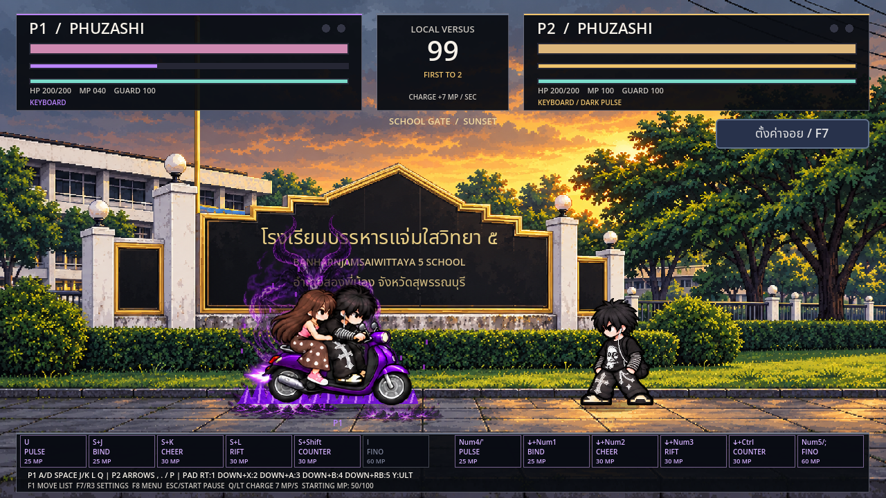
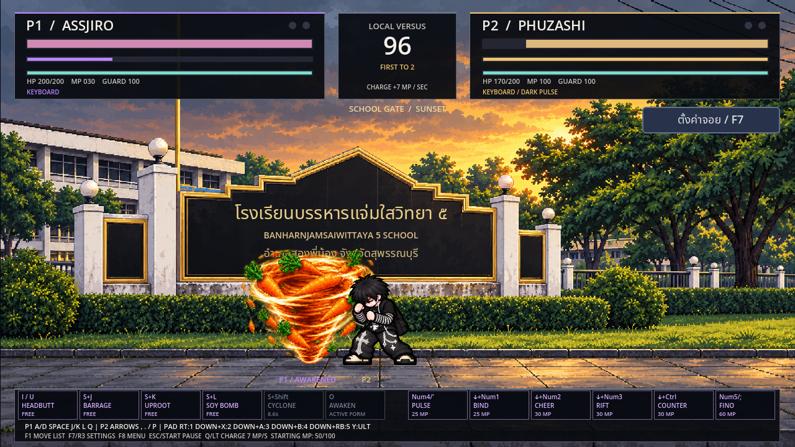
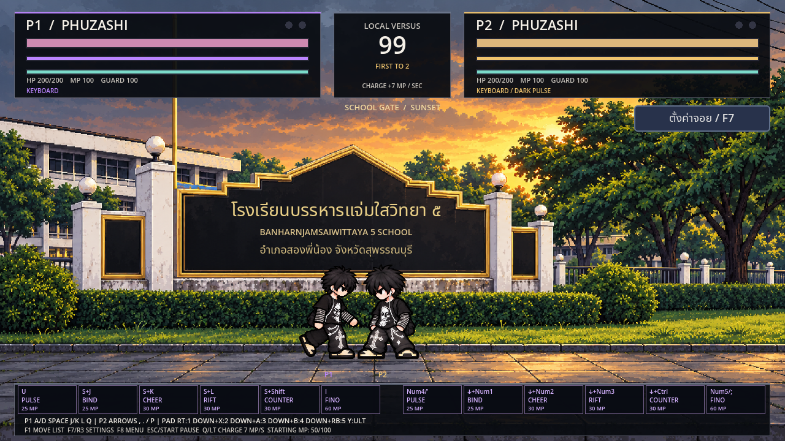

# ปุ่มนั่ง+สกิล · ดันตัว · แรงกระแทก · ฟีโน่ซ้อนท้าย

แตก ZIP → เปิด Godot 4.2.2 ขึ้นไป → Import `project.godot` → Import & Edit → รอนำเข้า → F5 เลือกตัวละครแล้วสู้สองผู้เล่นหรือฝึกเดี่ยว ทุกยกเริ่ม **50/100 มานา** เหมือนรุ่นก่อน ไม่มี EXE ใหม่

## ปุ่มใหม่ทั้งสามตัว

กดนั่งค้างก่อน แล้วกดปุ่มท่า กดครั้งเดียวต่อการใช้หนึ่งครั้ง การค้างปุ่มไม่รัวท่าเอง กดปุ่มนั่งและท่าในเฟรมเดียวกันได้ แต่ถ้าค้างปุ่มท่าอยู่ก่อนแล้วค่อยนั่งจะไม่ปล่อยสกิลเอง

| ช่อง | P1 / สนามฝึก | P2 | จอยค่าเริ่มต้น |
|---|---|---|---|
| 1 | U (ASSJIRO ใช้ I ได้ด้วย) | Num4 หรือ ' | RT / R2 |
| 2 | S + J | ลง + Num1 หรือ ลง + , | ลง + X / Square |
| 3 | S + K | ลง + Num2 หรือ ลง + . | ลง + B / Circle |
| 4 | S + L | ลง + Num3 หรือ ลง + / | ลง + LB / L1 |
| 5 | S + Shift | ลง + Ctrl | ลง + RB / R1 |
| 6 อัลติ | I (ASSJIRO ใช้ O) | Num5 หรือ ; | Y / Triangle |

ตามค่าเริ่มต้น T / Y / F บนคีย์บอร์ด, D-pad ขึ้น และสติ๊กขวา ไม่ใช่ทางลัดสกิลโดยตรงแล้ว U และอัลติยังใช้ปุ่มเดิม

ลง+ปุ่มเตะที่ตั้งเป็น K ใช้สกิลช่อง 3 เหมือน S+K (ค่าเริ่มต้นลง+B) ส่วนลง+A ไม่ใช่สกิลและไม่เก็บบัฟเฟอร์กระโดดไว้ เมื่อเปลี่ยนปุ่มจอยใน F7/R3 สกิลนั่งจะตามปุ่มปกติที่ตั้งไว้: ลง+ต่อย / ลง+เตะ / ลง+ป้องกัน / ลง+วิ่ง ค่าจอยปกติเดิมยังอยู่ และเลิกใช้แถวทางลัดสกิลเก่า

## สกิลแต่ละช่อง

| ช่อง | PHUZASHI | ASSJIRO ร่างแปลง | มวยไทย |
|---|---|---|---|
| 1 | Dark Pulse | หัวพุ่งแครอท | วานรศอกถล่ม |
| 2 | ปีศาจล็อกเป้า | หมัดรัวแครอท | เขี้ยววานรทะยาน |
| 3 | เรียกสาวเชียร์ | แครอทถอนราก | หมัดสะเทือนปฐพี |
| 4 | รอยแยกม่วง | ขวดซีอิ๊วดำ | อ้อมแขนวานร |
| 5 | เงาสวนกลับ | พายุแครอท | คำรามเจ้าป่า |
| อัลติ | ฟีโน่คู่ซ้อน | แปลงร่างซีอิ๊วดำ | ราชาวานรคลั่ง |

ค่าดาเมจของทั้ง 18 ท่ายังคงเดิมจากรุ่นก่อน ส่วนมานาและการเคลื่อนไหวเปลี่ยนตามรายละเอียดด้านล่าง

## เดินชนแล้วดัน

เพิ่มระยะสัมผัสตัวให้เหมาะกับรูปร่าง แก้การซ้อนกันเมื่อเดินสวนหรือวิ่งเข้าหา คำนวณหลังตัวละครทั้งสองเดินเสร็จในแต่ละเฟรมฟิสิกส์ คนเดินเข้ามาจะดันคนที่ยืนอยู่ หากทั้งสองเดินสวนกันจะรับแรงกันที่กึ่งกลาง หากอีกฝั่งกันอยู่จะดันได้ช้าลง

เมื่อดันถึงขอบฉาก คนเดินจะหยุด ไม่ทะลุหรือสลับตำแหน่ง เป้าหมายที่ถูกปีศาจล็อกจะเป็นจุดรับแรงและไม่ถูกดันเลื่อน การกระโดดข้าม Blink ฟีโน่ และร่างพายุยังข้ามตัวกันได้ตามชนิดท่า

## แรงสะเทือนเมื่อโดนโจมตี

หมัด เตะ กระสุน และสกิลใช้ระบบตอบสนองเดียวกัน: ตัวสั่น หยุดภาพกระแทกสั้น ๆ เสียงกระแทก และถอยออกจากตำแหน่งผู้โจมตีจริง

- หมัดเบาถอยน้อย เตะถอยมากขึ้น หมัด/เตะปิดคอมโบถอยแรงกว่า และฟีโน่ชนถอยแรงสุดในกลุ่มที่ตรวจ
- หมัดรัวถอยทีละน้อยเพื่อให้ต่อชุดได้ ส่วนจังหวะปิดผลักแรงขึ้น
- กันได้จะมีแรงสะเทือนและถอยเพียงเล็กน้อย จังหวะ Perfect Guard ยังคงป้องกันดาเมจ
- แรงถอยเกิดได้แม้อยู่ในสถานะโดนตีหรือการ์ดแตก แต่ไม่ใช่การเดินหนีจากสตัน
- HUD คงที่ กล้องสั่นเฉพาะฉาก จอยจริงที่เชื่อมอยู่และรองรับการสั่นจะรับแรงสั่นตามน้ำหนักการโจมตี

## ฟีโน่คู่ซ้อนและคัตอินอัลติ

PHUZASHI ขี่ฟีโน่ม่วงดำพร้อมตัวช่วยหญิงซ้อนท้ายทั้ง 16 เฟรม คงผมยาว เสื้อชมพู กระโปรงน้ำตาลลายจุดขาว และรองเท้าชมพู มีไฟม่วงรอบรถกับปีศาจเงาม่วงด้านหลัง เธอเป็นผู้ซ้อนในภาพอัลติ ไม่ได้ให้บัฟเชียร์เพิ่มโดยอัตโนมัติ

ทั้งสามตัวมีกรอบหน้าตัวละครด้านซ้ายเมื่อเริ่มอัลติสำเร็จ ใช้เวลาสั้น ๆ พร้อมการต่อสู้ หากกดอัลติพร้อมกันจะเล่นคัตอินต่อกัน จบยกหรือเริ่มใหม่ล้างคัตอินค้าง การเปิดตั้งค่าหรือพักเกมหยุดเวลาแอนิเมชันด้วย

## ASSJIRO: 70 มานาและร่างพายุ

แปลงร่างใช้ **70 MP** หากมี 100 จะเหลือ 30 หลังแปลง หากมี 70 จะเหลือ 0 จากนั้นสกิลโจมตีทั้งห้า **ไม่เสียมานา** และใช้ได้แม้มานาเป็น 0 แต่ยังติดคูลดาวน์:

| ท่า | คูลดาวน์ |
|---|---:|
| หัวพุ่งแครอท | 6 วิ |
| หมัดรัวแครอท | 8 วิ |
| แครอทถอนราก | 7 วิ |
| ขวดซีอิ๊วดำ | 7 วิ |
| พายุแครอท | 9 วิ |

ร่างใส่หมวกยังใช้สกิลโจมตีไม่ได้ แปลงร่างยังถูกขัดได้และไม่คืนมานาที่จ่ายไป ร่างหัวโล้นลดดาเมจ 30% เหมือนเดิม

พายุแครอทแทนภาพตัว ASSJIRO ทุกชั้น ระหว่างท่า 1.05 วินาทีจะไม่รับดาเมจ กระสุน หรือการล็อก เมื่อจบคืนร่างและโดนโจมตีได้ทันที ไม่มีอมตะค้าง ภาพลมสีส้มกับแครอทมี 16 เฟรม

## มวยไทยและแดช PHUZASHI

มวยไทยมีภาพท่ายืนเท้าปักพื้นและแดชใหม่ แยกร่างเต็มตามภาพจริงเพื่อไม่ให้เศษเท้าจากแถวอื่นติดมา แดชเคลื่อนที่ต่อเนื่อง เร่งแล้วผ่อนความเร็ว ใช้เวลา 0.32 วิ ระยะประมาณ 90px ไม่มีการย้ายตำแหน่งทันที และไม่มีอมตะ

PHUZASHI ใช้ Shadow Blink ด้วย E / L3 หรือกดซ้าย/ขวาสองครั้งเหมือนเดิม เปลี่ยนค่าใช้จ่ายจาก 15 เป็น **5 MP** ระยะและช่วงหลบยังเท่าเดิม

[วิดีโอในเกม](https://github.com/poohkk567-sys/game/blob/codex/chord-push-fino-duo/docs/PHUZASHI_Contact_Update.mp4?raw=true) · [ผลทดสอบ](CONTACT_TEST_REPORT.md)

