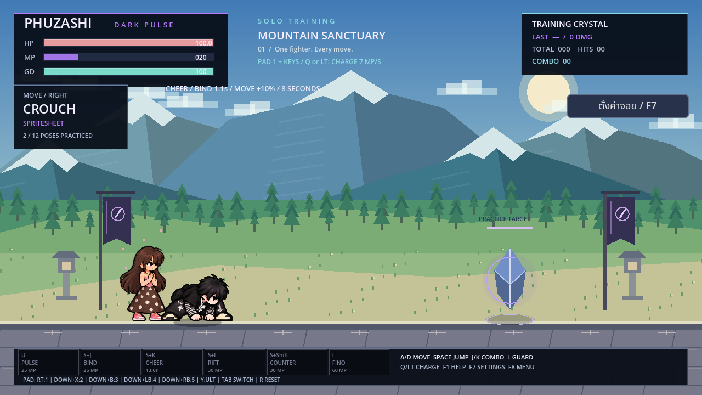

# แก้ปุ่มจอยให้ตรงกับคีย์บอร์ด

ก่อนหน้านี้ S+K บนคีย์บอร์ดเป็นสกิลช่อง 3 แต่จอยผูกช่องนี้กับปุ่มกระโดด ทำให้กดลง+ปุ่มเตะ K แล้วออกคนละท่า แก้ให้สกิลนั่งตามคำสั่งปกติเดียวกันทุกตัว ทุกฝั่ง และสนามฝึก

| คำสั่ง | P1 | P2 | จอยค่าเริ่มต้น |
|---|---|---|---|
| สกิลช่อง 1 | U | Num4 / ' | RT / R2 |
| ลง+ต่อย | S+J | ลง+Num1 / , | ลง+X / Square |
| ลง+เตะ | S+K | ลง+Num2 / . | ลง+B / Circle |
| ลง+ป้องกัน | S+L | ลง+Num3 / / | ลง+LB / L1 |
| ลง+วิ่ง | S+Shift | ลง+Ctrl | ลง+RB / R1 |
| อัลติ | I (ASSJIRO: O) | Num5 / ; | Y / Triangle |

**PHUZASHI: ลง+ปุ่มเตะ = เรียกสาวเชียร์** เหมือน S+K ใช้ 30 มานา ค่าเริ่มต้นคือ B / Circle ถ้าตั้งปุ่มเตะไว้เป็นปุ่มอื่น ให้ใช้ลง+ปุ่มนั้นได้เลย ไม่ต้องรีเซ็ตค่าจอยเดิม

ASSJIRO ช่องเดียวกันเป็นแครอทถอนราก มวยไทยเป็นหมัดสะเทือนปฐพี คีย์บอร์ดและจอยเรียกท่าเดียวกัน ปุ่มกระโดด A ไม่ผูกกับสกิลนั่งแล้ว และไม่ทิ้งบัฟเฟอร์ให้กระโดดเองหลังปล่อยลง

## เปิดเล่น

แตก ZIP ทั้งหมด → Godot 4.2.2+ Import `project.godot` → Import & Edit → รอนำเข้า → F5 เลือก PHUZASHI → กดลงค้างแล้วกดปุ่มเตะ เริ่มที่ 50 มานาจึงเรียกเชียร์ได้ทันทีหนึ่งครั้ง

F7/R3 ตั้งปุ่มจอย ดู [คู่มือส่วนอื่นของเกม](CONTACT_UPDATE_TH.md) รุ่นนี้เป็นซอร์ส Godot ไม่มี EXE ใหม่

## ผลตรวจ

ตรวจด้วย Godot 4.2.2 และ 4.6.3 ชุดที่เกี่ยวข้องผ่าน **443 ข้อต่อเวอร์ชัน** ไม่มี SCRIPT ERROR หรือข้อทดสอบล้มเหลว:

- `test_controller_parity.gd`: 134 ข้อ เปรียบเทียบ InputEventKey จริงกับ InputEventJoypadButton จริง ทุกสกิลนั่งของทั้งสามตัว ทั้ง P1/P2 ทั้งค่าเริ่มต้นและเปลี่ยนปุ่มเตะ/ป้องกัน
- ตรวจว่าปุ่มจอยไม่กระตุ้นผู้เล่นอีกฝั่ง และกดลง+กระโดดไม่ปล่อยท่าหรือกระโดดตามหลังโดยไม่ได้ตั้งใจ
- สนามฝึกกดจอยลง+B แล้วเกิด CHEER ใช้ 30 MP ตัวช่วยหญิงวิ่งเข้ามาจริงและให้บัฟ
- `test_contact_controls.gd` 108 ข้อ, `test_six_skills.gd` 111 ข้อ, `test_gamepads.gd` 54 ข้อ และ `test_controller_settings.gd` 36 ข้อ
- เก็บภาพสนามฝึกจริงจาก Godot 4.6.3 ด้วย `tools/capture_controller_parity.gd`

ทดสอบจอยผ่านอินพุตจำลองใน Godot ยังไม่ได้ลองฮาร์ดแวร์จอยจริงบน Windows รอบนี้ ภาพตัวละครและกติกาการต่อสู้อื่นคงเดิม

