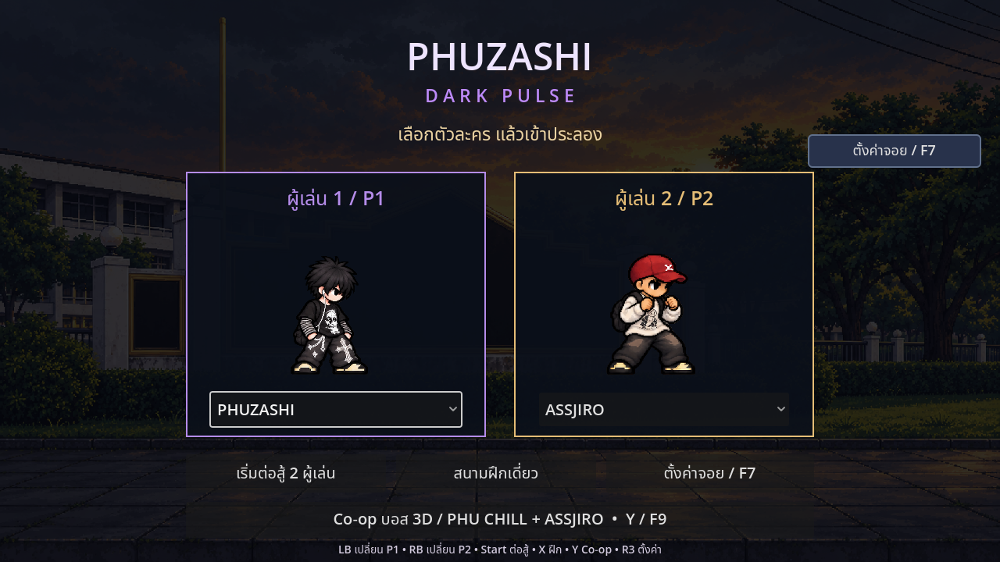
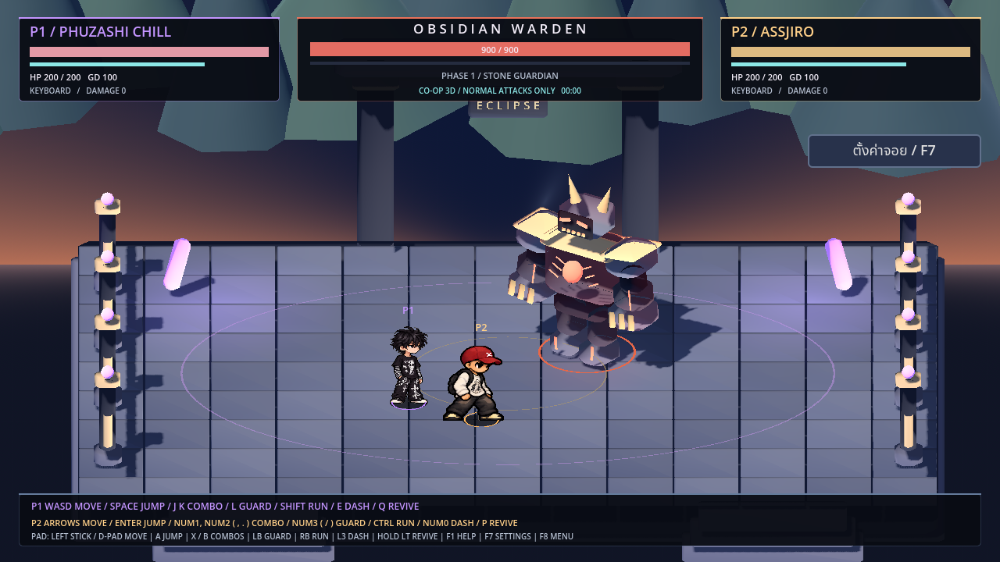
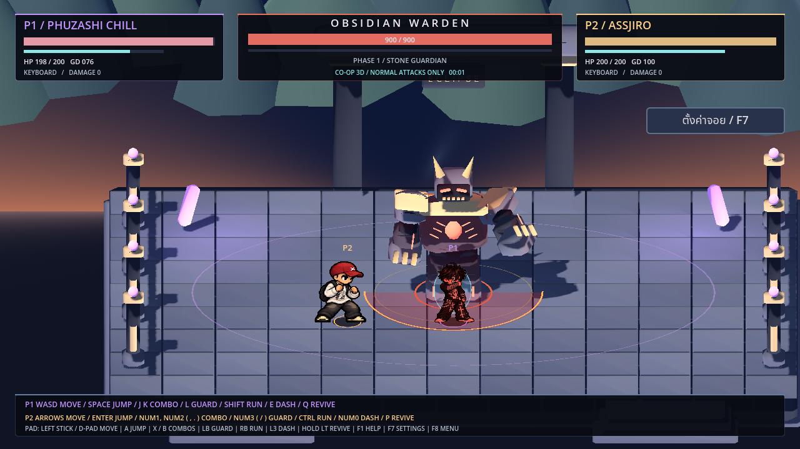
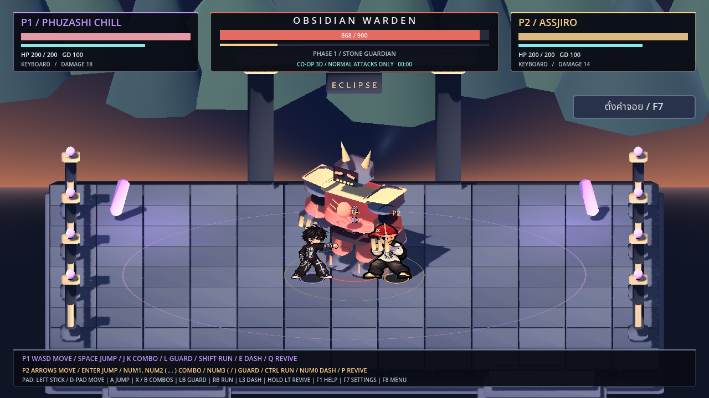
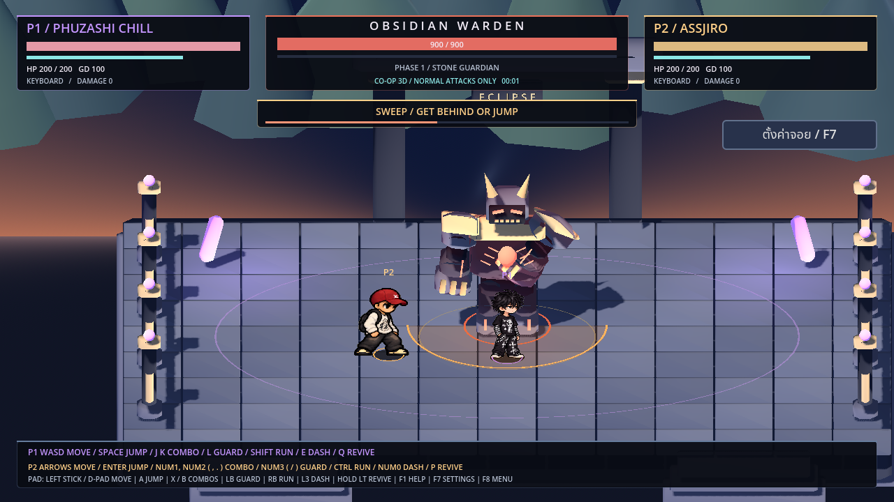
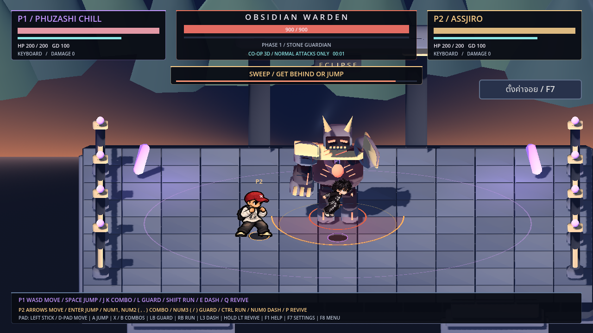
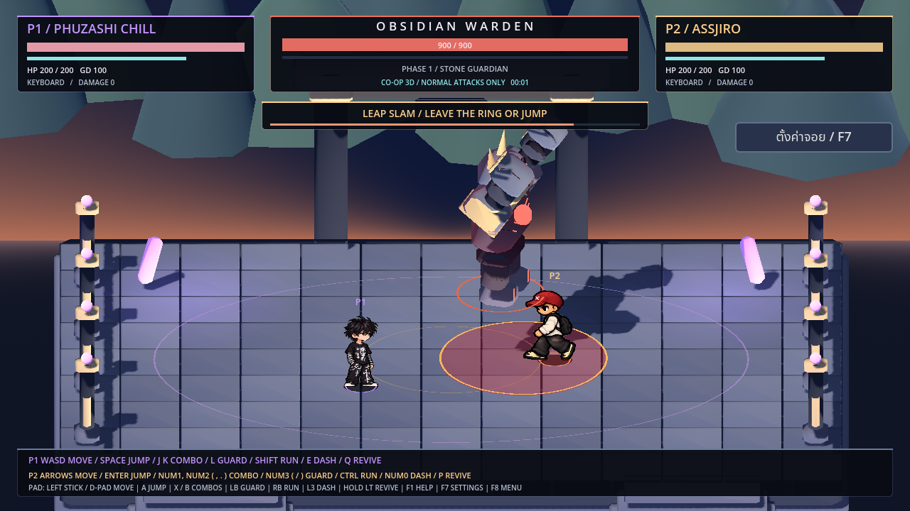
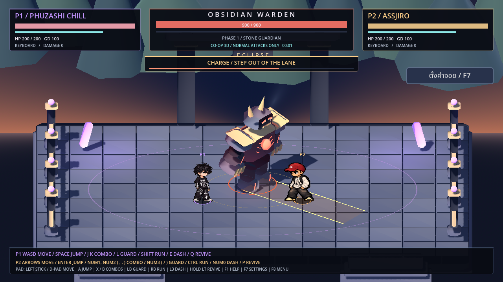
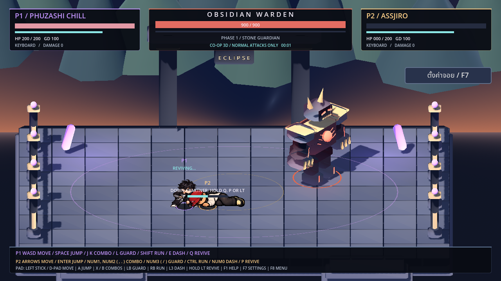

# Co-op บอส 3D — PHU CHILL + ASSJIRO

โหมดทดลอง **สองคนในเครื่องเดียว** ใช้ตัวละครพิกเซลเดิมวางบนสนามสามมิติ (2.5D) พื้น บอส แสง เงา และการชนเป็น3Dจริง ใช้กล้องร่วมกันที่เลื่อนและซูมให้เห็นทั้งทีมกับบอส

รอบนี้ใช้ **P1 PHUZASHI CHILL / P2 ASSJIRO ร่างหมวก** แบบตายตัว มีท่าพื้นฐานก่อน ยังไม่เปิดสกิลพิเศษ อัลติ แปลงร่าง หรือระบบมานาในโหมดนี้ โหมดต่อสู้2Dเดิมยังเล่นได้พร้อมสกิลเดิมครบ

[ดาวน์โหลดโปรเจกต์ Godot](https://github.com/poohkk567-sys/game/archive/refs/heads/codex/coop-3d-source.zip) · [คลิปเล่นจริง](https://github.com/poohkk567-sys/game/blob/codex/coop-3d-boss-prototype/docs/PHUZASHI_Coop_3D_Preview.mp4?raw=true) · [ผลทดสอบ](COOP_3D_TEST_REPORT.md)

## เข้าเล่น

แตกZIP → Godot4.2.2ขึ้นไป → Import `project.godot` → Import & Edit → รอนำเข้า → F5 ที่หน้าแรกกด **Co-op บอส 3D / PHU CHILL + ASSJIRO** หรือกด **F9 / Y บนจอย** จะเข้าสนาม Eclipse Courtyard

## ปุ่ม

| คำสั่ง | P1 / PHU CHILL | P2 / ASSJIRO | จอยค่าเริ่มต้น |
|---|---|---|---|
| เดินบนพื้น4ทิศ | WASD | ลูกศร | สติ๊กซ้าย / D-pad |
| วิ่ง | Shift ค้างพร้อมเดิน | Ctrl ค้างพร้อมเดิน | RB/R1 ค้างพร้อมเดิน |
| กระโดด | Space | Enter หรือ Num Enter | A / Cross |
| ต่อย | J | Num1 หรือ , | X / สี่เหลี่ยม |
| เตะ | K | Num2 หรือ . | B / วงกลม |
| กัน | L ค้าง | Num3 หรือ / ค้าง | LB / L1 ค้าง |
| แดช | E | Num0 หรือ \\ | L3 |
| ชุบเพื่อน | Q ค้าง | P ค้าง | LT / L2 ค้าง |
| พัก/เล่นต่อ | Esc | Esc | Start / Options |
| รายการปุ่ม | F1 | F1 | Back / Share |
| ตั้งจอย/ปุ่ม | F7 | F7 | R3 |
| สู้ใหม่ | R | R | Start หลังแพ้/ชนะ |
| กลับเมนู | F8 | F8 | ปุ่มบนหน้าพัก/จบเกมใช้เมาส์ได้ |

W และลูกศรขึ้นในโหมดนี้ใช้เดินเข้าฉาก ไม่ใช่กระโดด ใช้ Space/Enter/A แทน เมื่อกลับโหมด2D ปุ่มกระโดดเดิมยังอยู่ จอยสองอันควบคุมคนละตัว จอยหนึ่งอันเริ่มที่P2เพื่อให้P1ใช้คีย์บอร์ด และกดF5สลับฝั่งได้ ตั้งการจับคู่จอย1/จอย2ในF7เหมือนเดิม ปุ่มต่อย เตะ กระโดด กัน วิ่ง แดช และชุบ(LT/คำสั่งชาร์จเดิม) ตามปุ่มที่ตั้งใหม่ ส่วนการเดินลึกใช้แกนYสติ๊กซ้าย/ขึ้นลงD-pad

## การต่อสู้พื้นฐาน

- กดต่อยหรือเตะ3ครั้งเพื่อเตรียมคอมโบ3จังหวะ ภาพใช้ท่าของแต่ละตัวจริง หมัดรวม8+10+16=34 เตะรวม14+16+22=52
- กระโดดต่อย9 / กระโดดเตะ15ได้ แต่ละการโจมตีต้องชนระยะในพื้นที่3Dจริง ไม่ตีเพียงเพราะภาพอยู่ใกล้กันบนจอ ไม่มีการโจมตีโดนเพื่อน
- ตัวละครหันและเล็งท่าเริ่มต้นเข้าหาบอส เมื่อออกหมัดแล้วทิศไม่เปลี่ยนตามบอสกลางท่า ยังใช้ภาพหันซ้าย/ขวาเดิม ไม่ใช่โมเดลตัวละครหมุนได้รอบตัว
- แดชเป็นการเคลื่อนที่กายภาพ ไม่ใช้มานาและไม่มีอมตะ ระยะข้างต้นเป็นกติกาของต้นแบบ3Dเท่านั้น
- การ์ด100 กันปกติเสียเลือด2ต่อครั้งและใช้เกจ24 (ทุบ40) กันทันใน0.12วินาทีเป็นPerfect Guard ไม่เสียเลือด/เกจ มีโล่3Dโปร่งใสและแรงถอยเมื่อรับการโจมตี
- เกจหมดติดชะงัก1วินาที แล้วได้เกจอย่างน้อย50 ปล่อยการ์ด1วินาทีจึงฟื้น20หน่วย/วินาที

## บอส Obsidian Warden

บอสหินเกราะสามมิติ เลือด900 ผู้เล่นคนละ200 มีสามท่า โดยวางสัญญาณเตือนก่อนโจมตี:

1. **Sweep:** กวาดครึ่งวงด้านหน้า22ดาเมจ ออกไปด้านหลัง/ออกระยะ หรือกระโดดหลบ
2. **Leap Slam:** ล็อกวงลงพื้นล่วงหน้า กระโดดไปลงตำแหน่งนั้นอย่างต่อเนื่อง32ดาเมจ เดินออกจากวงหรือกระโดดให้พ้นตอนกระแทก
3. **Charge:** เตือนช่องพุ่งแนวตรง แล้วพุ่งไปตามแนวนั้น26ดาเมจ หลบออกด้านข้าง โดนแต่ละคนได้ครั้งเดียวต่อการพุ่ง

เลือดต่ำกว่าครึ่งจะเป็นPhase2 เริ่มท่าเร็วขึ้นและเพิ่มดาเมจแต่ละท่า4 เมื่อช่วยกันสะสมเกจBREAKครบ140 บอสจะเสียหลัก2วินาทีและรับดาเมจแรงขึ้น20% หยุดคอมโบบอสได้ แต่ไม่ทำให้ติดชะงักตลอดเวลา

## ช่วยเพื่อนและจบเกม

เมื่อคนหนึ่งเลือดหมดจะล้มอยู่บนพื้น คนที่เหลือต้องเข้าใกล้ใน1.8เมตร ยืนนิ่งแล้วค้างQ/P/LTเป็นเวลา1.8วินาทีเพื่อชุบ ได้เลือด70และช่วงป้องกันสั้นๆ โดนโจมตี ออกระยะ ปล่อยปุ่ม หรือเริ่มเคลื่อนไหวจะยกเลิกความคืบหน้า

ทั้งคู่ล้มจะแพ้ บอสเลือดหมดจะชนะ มีปุ่มสู้ใหม่/กลับเมนู การพักเกม เปิดตั้งค่าจอย หรือจอยหลุดจะหยุดการต่อสู้ให้ตรวจจอยก่อนเล่นต่อ

นี่เป็นต้นแบบเล่นในเครื่องเดียว ไม่มีระบบออนไลน์ และยังไม่ย้ายสกิลพิเศษจาก2Dมา3D ไม่มีEXEใหม่ในชุดนี้
