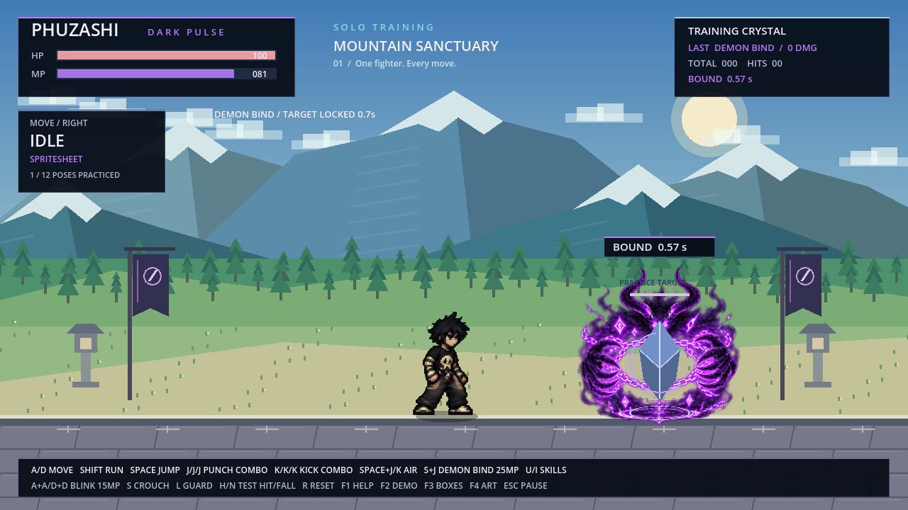

# Demon Bind — ปีศาจล็อกเป้า

[ดาวน์โหลดโปรเจกต์ Godot สำหรับลองเล่น](https://github.com/poohkk567-sys/game/blob/codex/demon-bind-skill/docs/downloads/PHUZASHI_Demon_Bind_Godot.zip?raw=true)

แตก ZIP → Godot 4.2.2 ขึ้นไป → Import `project.godot` → F5

กด **S ค้างแล้วกด J** หรือกด **S+J พร้อมกัน** เพื่อเรียกปีศาจเงา
สกิลใช้ **25 MP ต่อการร่าย** เลือกเป้าที่ใกล้ที่สุดด้านหน้าในระยะ 620 พิกเซล
เมื่อปีศาจบินไปจับติด เป้าจะขยับไม่ได้ **0.7 วินาที** แล้วหลุดอัตโนมัติ

ปีศาจมีภาพเอฟเฟกต์ใหม่ 16 เฟรม ตั้งแต่ปรากฏตัว พุ่งเข้าหาเป้า โอบจับด้วยกรงเล็บ
และโซ่ม่วง ไปจนถึงสลายตัว แสดงเวลาที่เหลือเหนือเป้าและบน HUD

ในฉากฝึกใช้กับคริสตัลที่มีอยู่ คริสตัลจะหยุดลอยและหยุดสั่นขณะถูกล็อก
ระบบเดียวกันหยุดการเคลื่อนที่และคำสั่งของตัวละคร รวมทั้งหยุด AI ที่กำลังเคลื่อนที่ได้
โดยไม่หยุดทั้งเกม ผู้ร่ายยังเล่นต่อได้หลังจบท่าร่าย

- เป็นสกิลควบคุม ไม่ทำดาเมจเอง สามารถตามด้วยท่าโจมตีอื่นได้
- ใช้บนพื้น ระหว่างท่าโจมตีอื่นหรือ Shadow Blink จะร่ายแทรกไม่ได้
- ต้องมี MP อย่างน้อย 25 หากไม่มีเป้าในระยะ สกิลจะพลาดและยังใช้ MP ตามปกติ
- กดค้างไม่ร่ายซ้ำอัตโนมัติ ปล่อย S ก่อนกด J เพื่อกลับมาต่อยปกติ
- ร่ายซ้ำที่เป้าเดิมจะเริ่มระยะล็อกใหม่สูงสุด 0.7 วินาที ไม่บวกเวลาค้างสะสม
- กด Esc หยุดทั้งภาพปีศาจกับเวลาล็อก กด R ล้างท่า สถานะ และเอฟเฟกต์ทั้งหมด
- F2 สาธิต 18 รายการ รวม Demon Bind; F1 มีปุ่มและค่ามานา

คอมโบ J–J–J / K–K–K หมัดม่วง ท่ากระโดด และเอฟเฟกต์ Shadow Blink ยังอยู่ครบ
ภาพต้นฉบับตัวละครไม่ถูกเปลี่ยน ใช้ภาพท่าร่ายเต็มตัวที่มีอยู่

[วิดีโอจากเกมจริง: ร่ายและปล่อยล็อกทั้งซ้าย–ขวา](PHUZASHI_Demon_Bind.mp4)

ชุดนี้เป็นไฟล์โปรเจกต์ Godot ไม่มี EXE ใหม่
