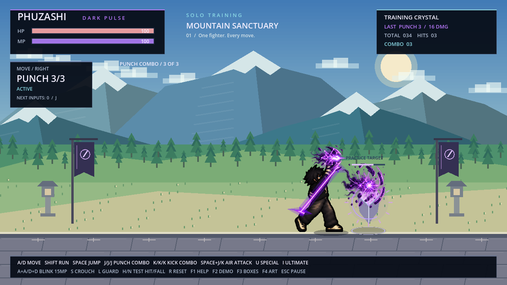
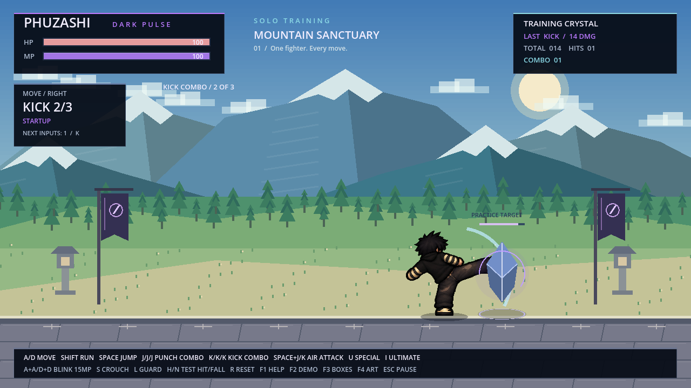
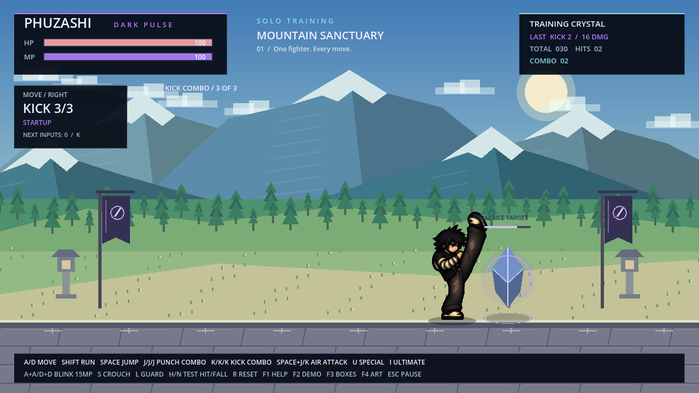

# คอมโบท่าใหม่และหมัดม่วง

[ดาวน์โหลดชุดทดสอบ Godot ZIP](https://github.com/poohkk567-sys/game/blob/codex/distinct-combo-poses/docs/downloads/PHUZASHI_Distinct_Combos_Godot.zip?raw=true)

แตก ZIP → Godot 4.2.2 ขึ้นไป → Import `project.godot` → F5

| คอมโบ | จังหวะที่ 1 | จังหวะที่ 2 | จังหวะที่ 3 |
| --- | --- | --- | --- |
| J–J–J | หมัดตรงเดิม / 8 DMG | หมัดฮุกบิดตัว / 10 DMG | อัปเปอร์คัตพลังม่วง / 16 DMG |
| K–K–K | เตะเดิม / 14 DMG | หมุนตัวเตะ / 16 DMG | ยกขาเตะฟาด / 22 DMG |

เพิ่มสไปรต์ใหม่ 4 ชุด ชุดละ 8 เฟรม รวม 32 เฟรม ทั้งท่าเตรียม หมุนตัว ออกอาวุธ
และเก็บท่า อ้างอิงทรงผม ใบหน้า เสื้อกะโหลก แขนลายแถบ กางเกง และรองเท้า
จากภาพตัวละครเดิม ไฟล์ต้นฉบับและภาพท่าหลักเดิมยังอยู่ครบ

หมัดที่ 3 มีพลังม่วงสะสมที่มือ เส้นพลังตามทางยกหมัด สายฟ้ารอบกำปั้น
และระเบิดม่วงเมื่อโดนเป้าจริง เอฟเฟกต์ตามจุดกำปั้นของแต่ละเฟรมและหันตามตัวละคร
หากต่อยพลาดจะเห็นพลังที่มือแต่ไม่มีระเบิดโดนเป้า

ยังทำดาเมจรวม 34 สำหรับหมัดและ 52 สำหรับเตะ ท่าปกติไม่ใช้ MP
กด 3 ครั้งล่วงหน้าได้ กดค้างอย่างเดียวไม่ต่อคอมโบอัตโนมัติ
Space+J/K ยังเป็นกระโดดต่อย/เตะ ส่วน Shadow Blink กับท่าสกิลเดิมยังใช้ได้
กด R ล้างคอมโบและเอฟเฟกต์ หรือ Esc หยุด/เล่นต่อ

[วิดีโอในเกมจริง ทั้งซ้ายและขวา ความเร็ว 60% เพื่อดูท่า](PHUZASHI_Distinct_Combos.mp4)

## สไปรต์ชีตต้นทาง

อ่านแต่ละภาพจากซ้ายไปขวา แถวบนแล้วแถวล่าง ชุดละ 8 เฟรม พื้นหลังโปร่งใส

- [หมัดที่ 2](../assets/characters/combos/punch_2_hook.png)
- [หมัดที่ 3 — พลังม่วงเป็นชั้นแยกในเกม](../assets/characters/combos/punch_3_uppercut.png)
- [เตะที่ 2](../assets/characters/combos/kick_2_spin.png)
- [เตะที่ 3](../assets/characters/combos/kick_3_axe.png)

ชุดดาวน์โหลดเป็นโปรเจกต์ Godot ไม่มี EXE ใหม่
