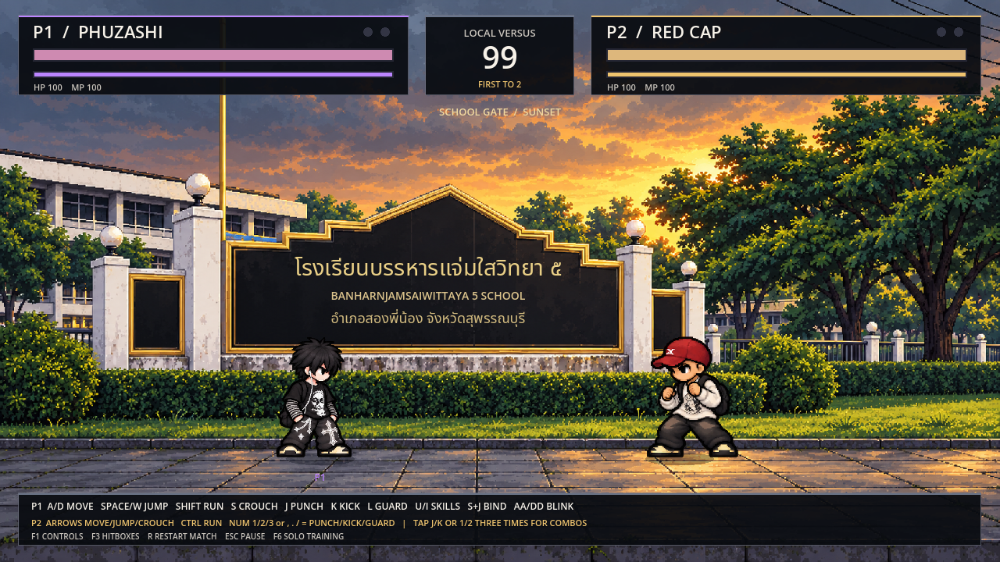
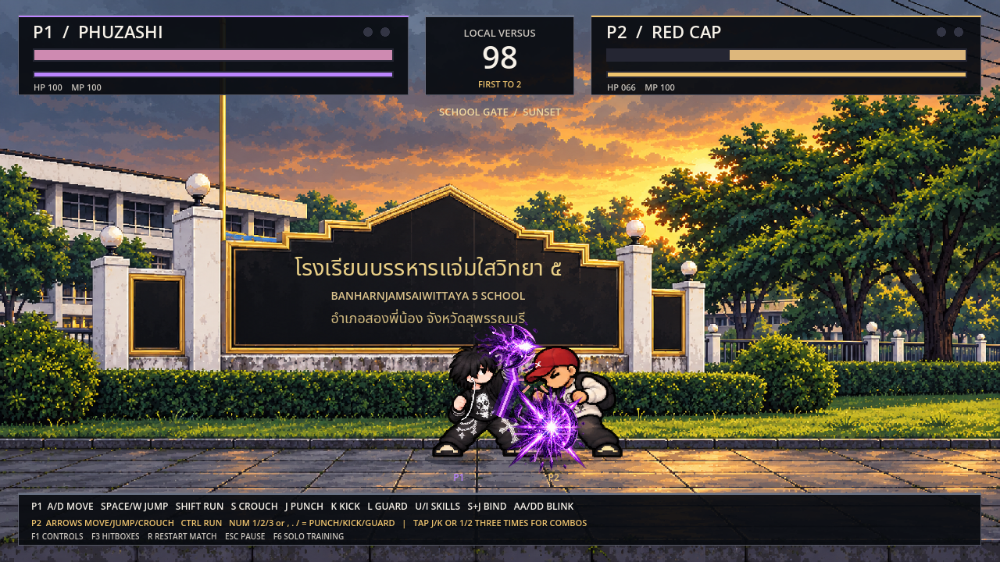
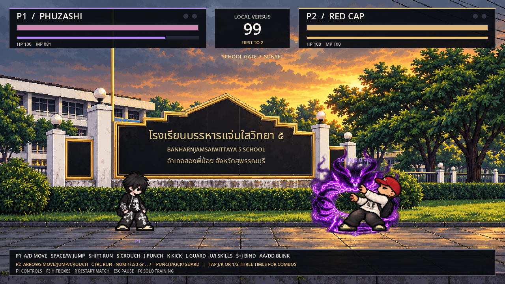

# PHUZASHI — DARK PULSE / หน้าโรงเรียน · 2 ผู้เล่น

> เอกสารรุ่นก่อน: ปุ่มและกติกาปัจจุบันดู [สามตัวละคร/ตั้งค่าจอย/ฟีโน่/บัฟเชียร์](ROSTER_CONTROLLERS_TH.md)

> รุ่นล่าสุดเพิ่ม [มานา เกจป้องกัน สกิลแครอท และจอยสองผู้เล่น](MANA_GUARD_CARROT_GAMEPADS_TH.md) ดูปุ่มปัจจุบันที่ลิงก์นี้หรือ F1 ในเกม

[ดาวน์โหลดเกมทดสอบ Godot (.zip)](https://github.com/poohkk567-sys/game/blob/codex/mana-guard-carrot-gamepads/docs/downloads/PHUZASHI_Mana_Carrot_Gamepads_Godot.zip?raw=true)

แตก ZIP ทั้งหมด → เปิด Godot 4.2.2+ → Import `project.godot` → F5
เกมเริ่มที่สนามหน้าโรงเรียนตามรูปอ้างอิง มี PHUZASHI แบบใหม่ผิวขาว และ RED CAP แบบไม่มีผม บังคับคนละตัวพร้อมกันบนคีย์บอร์ดเดียว

## ปุ่มสองผู้เล่น

| การกระทำ | ผู้เล่น 1: PHUZASHI | ผู้เล่น 2: RED CAP |
| --- | --- | --- |
| เดิน | A / D | ลูกศรซ้าย / ขวา |
| กระโดด | Space หรือ W | ลูกศรขึ้น |
| วิ่ง | Shift | Ctrl |
| หมอบ | S | ลูกศรลง |
| ต่อย | J | Numpad 1 หรือ , |
| เตะ | K | Numpad 2 หรือ . |
| ป้องกัน | L | Numpad 3 หรือ / |
| คอมโบต่อย | J–J–J | 1–1–1 หรือ , สามครั้ง |
| คอมโบเตะ | K–K–K | 2–2–2 หรือ . สามครั้ง |
| กระโดดต่อย/เตะ | Space + J/K | ขึ้น + 1/2 หรือ ,/. |
| สกิลหลัก | U · Dark Pulse 25 MP | Numpad4 หรือ apostrophe: หัวพุ่ง25 MP |
| Ultimate | I มังกร · 60 MP | Numpad5 หรือ ; แปลงร่าง · 100 MP |
| หมอบ+ต่อย | S+J ปีศาจ25 MP · ล็อก0.7วินาที | ลง+ต่อย หมัดรัวแครอท30 MP |
| Shadow Blink | A A / D D · 15 MP | ไม่มี Blink |
| ค้างชาร์จมานา | Q · 7 MP/วินาที | P · 7 MP/วินาที |

F1 ดูปุ่มทั้งหมด · F3 แสดง hitbox · R เริ่มแมตช์ใหม่ · Esc หยุด/เล่นต่อ · F6 สลับสนามฝึกคนเดียว/สนามต่อสู้
สนามฝึกที่เข้าจาก F6 ใช้โมเดลใหม่เช่นกัน กด Tab สลับตัวละครเมื่อฝึกคนเดียว

## กติกา

- แต่ละยกมี99วินาที ชนะครบ2ยกชนะทั้งแมตช์
- โจมตีอีกฝ่ายเพื่อลด HP ให้เหลือ0 หรือมี HP มากกว่าเมื่อหมดเวลา ถ้า HP เท่ากันถือว่าเสมอ
- เริ่มยกมีนับเตรียมตัว จบยกแล้วรีเซ็ต HP/MP/ตำแหน่งให้ยกถัดไป คะแนนแมตช์คงอยู่
- เดินถอยหลังได้และหันเข้าหาคู่แข่งอัตโนมัติ กระโดดหรือ Blink ข้ามอีกฝั่งได้
- ป้องกันขณะหันเข้าหาคู่แข่งลดความเสียหายเหลือ2 การโดนโจมตีหยุดคอมโบ และผู้แพ้จะล้มนอน
- ปุ่มของผู้เล่นทั้งสองแยกกัน ตัวละครเป็นผู้เล่นจริงทั้งคู่ ไม่มี AI บังคับแทน
- เมื่อออกจากหน้าต่างเกม ระบบหยุดเกมและปล่อยปุ่มที่ค้างไว้ กด Esc กลับมาเล่นต่อ

## โมเดลและเอฟเฟกต์

PHUZASHI เปลี่ยนเป็นแบบใหม่ที่ผู้ใช้เลือกครบ128เฟรม เสื้อใบหน้า แขนลายทางถี่ กางเกงกางเขน/โซ่ หูฟัง และผิวขาวอมชมพู ยึดสัดส่วนและน้ำหนักเส้นให้เข้าชุดกับ RED CAP
คงท่า คอมโบ ดาเมจ ระยะเวลา MP และเอฟเฟกต์เดิมของ PHUZASHI ทั้ง Dark Pulse มังกร หมัดม่วง Shadow Blink และปีศาจล็อกเป้า ตัวหมวกแดงใช้ท่าปกติเดิมครบ และมี [อัลติแปลงร่างใช้100MP](RED_CAP_TRANSFORM_TH.md)

[วิดีโอจากเกมจริง](PHUZASHI_Local_Versus.mp4) · [รายละเอียดสไปรต์ใหม่](../assets/characters/phuzashi_clear/README_TH.md)

ไม่มี EXE ใหม่ในรุ่นนี้ เปิดผ่าน Godot ตามขั้นตอนด้านบน
