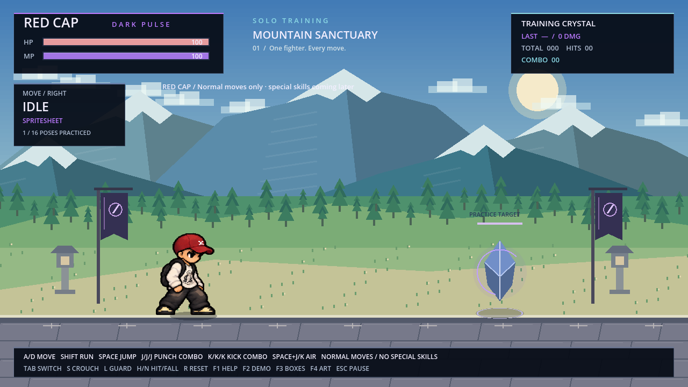

# RED CAP — หมวกแดง ไม่มีผม / ท่าปกติครบ

> เอกสารรุ่นก่อน: ปุ่มและกติกาปัจจุบันดู [สามตัวละคร/ตั้งค่าจอย/ฟีโน่/บัฟเชียร์](ROSTER_CONTROLLERS_TH.md)

[ดาวน์โหลดโปรเจกต์เล่นผ่าน Godot](https://github.com/poohkk567-sys/game/blob/codex/red-cap-normal-moves/docs/downloads/PHUZASHI_Red_Cap_Normals_Godot.zip?raw=true)

[ดาวน์โหลดสไปรต์ชีตแยก](https://github.com/poohkk567-sys/game/blob/codex/red-cap-normal-moves/docs/downloads/RED_CAP_Normal_Spritesheets.zip?raw=true)

แตก ZIP → เปิด Godot 4.2.2+ → Import `project.godot` → F5 → กด **Tab** สลับ PHUZASHI / RED CAP
F2 สาธิตท่าของตัวที่เลือก F1 ดูรายการปุ่ม มีตัวเล่นในสนามทีละตัวและคริสตัลฝึก

## ท่าที่เล่นได้

- A/D เดินและหันตามทิศทาง · Shift วิ่ง · Space กระโดด · S หมอบ · L ป้องกัน
- J–J–J: หมัดตรง → หมัดฮุกบิดตัว → อัปเปอร์คัต (8 + 10 + 16 ดาเมจ)
- K–K–K: เตะตรง → หมุนเตะ → เตะสับจากด้านบน (14 + 16 + 22 ดาเมจ)
- Space+J กระโดดต่อย (9 ดาเมจ) · Space+K กระโดดเตะ (15 ดาเมจ) ใช้ A/D ควบคุมกลางอากาศได้
- H/N ทดลองโดนโจมตี/ล้ม · R รีเซ็ต · Esc หยุด/เล่นต่อ
- กดค้างไม่ต่อคอมโบ ต้องแตะครบสามครั้ง และกดล่วงหน้าเพื่อเก็บจังหวะต่อท่าได้

ตัวใหม่มี 14 ท่าที่วาดแยก รวม **112 เฟรมเต็มตัว** และใช้รูปของตัวเองสำหรับโจมตีกลางอากาศ รวม 16 สถานะท่าปกติ หมวกยังอยู่บนหัวขณะล้มและไม่มีผมโผล่ในทุกท่า

สกิลพิเศษของตัวหมวกแดงยังเว้นไว้ตามที่ขอ U / I / S+J และ Shadow Blink ยังไม่เปิดใช้ หมัดที่สามเป็นอัปเปอร์คัตกายภาพ ส่วน PHUZASHI ยังคงมีสกิลเดิมครบเมื่อกด Tab กลับไป

[วิดีโอจากเกมจริง](PHUZASHI_Red_Cap_Normals.mp4) · [แผ่นท่าต่อย/เตะ](../assets/characters/red_cap/punch_kick.png) · [คอมโบหมัด](../assets/characters/red_cap/punch_combo.png) · [คอมโบเตะ](../assets/characters/red_cap/kick_combo.png) · [รายละเอียดเฟรม/ไฟล์](../assets/characters/red_cap/README_TH.md)

## การตรวจสอบ

- Godot 4.2.2 และ 4.6.3: 459 checks ต่อเวอร์ชัน รวมระบบเดิม 382 checks และตัวใหม่ 77 checks
- ตรวจการวาดตัวหมวกแดงด้วยทั้งสองเวอร์ชัน 224 เฟรม รวม 112 ภาพในสองทิศทาง ไม่มีภาพขาด/หลุดกรอบและจุดพื้นตรงกัน
- ตรวจภาพเดิมของ PHUZASHI เพิ่ม 472 ตัวอย่างด้วย Godot 4.6.3 ผ่านทั้งหมด รวมการตรวจภาพ 696 ตัวอย่างในเวอร์ชันนี้
- ตรวจการต่อคอมโบ ดาเมจจริง กระโดดโจมตี ป้องกัน ฟื้นจากล้ม pause/reset และสลับตัวระหว่างโจมตี
- ตรวจว่าตัวใหม่ไม่ใช้ภาพ/สกิล/เอฟเฟกต์พลังม่วงของตัวแรก และสลับกลับแล้วยังใช้ Dark Pulse ได้
- Resource สร้างด้วย Godot 4.2.2 เพื่อเปิดได้ทั้งสองเวอร์ชัน

ไม่มี EXE ใหม่ในชุดนี้ ภาพถ่ายบุคคลต้นทางไม่ได้ถูกใส่ใน Repository
