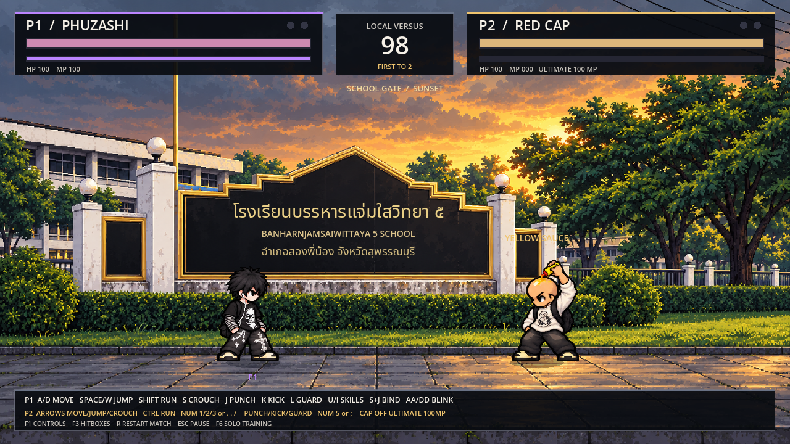
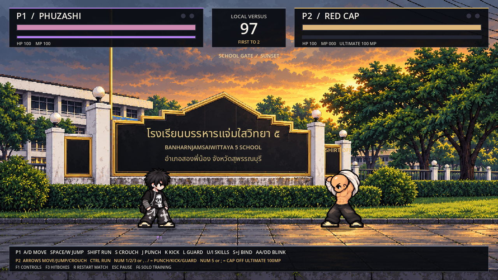

# Red Cap: อัลติถอดหมวก / ซอสเหลือง / ถอดเสื้อ

> เอกสารรุ่นก่อน: ปุ่มและกติกาปัจจุบันดู [สามตัวละคร/ตั้งค่าจอย/ฟีโน่/บัฟเชียร์](ROSTER_CONTROLLERS_TH.md)

> รุ่นปัจจุบัน: [มานา/การ์ด/จอยและสกิลแครอท](MANA_GUARD_CARROT_GAMEPADS_TH.md) สนามฝึกใช้ **O แปลงร่าง** เพราะ I เปลี่ยนเป็นหัวพุ่งแล้ว; P2 ยังคง Num5 / ; และจอย Y

[ดาวน์โหลดเกมทดสอบ Godot (.zip)](https://github.com/poohkk567-sys/game/blob/codex/mana-guard-carrot-gamepads/docs/downloads/PHUZASHI_Mana_Carrot_Gamepads_Godot.zip?raw=true)

แตก ZIP → Godot4.2.2+ Import project.godot → F5 เกมเปิดสนามโรงเรียนแบบสองผู้เล่นเหมือนรุ่นก่อน

- ผู้เล่น2 RED CAP กด **Numpad5 หรือ ;** ขณะมานาเต็ม100และยืนพร้อมออกท่า
- ในสนามฝึก F6 เลือก RED CAP ด้วย Tab แล้วกด **O**
- ใช้มานา100ทันที แสดงแอนิเมชัน3.2วินาที: ถอดหมวกเผยหัวโล้น → หยิบขวดซอสเหลืองเหยาะหัว → ถอดเสื้อและกระเป๋า → ตั้งการ์ดร่างใหม่
- ร่างใหม่คงอยู่จนจบยก/รีเซ็ต ไม่กลับเป็นร่างใส่หมวกเมื่อเดิน กระโดด ต่อย เตะ โดนโจมตี หรือถูกปีศาจล็อก
- กดซ้ำเมื่อแปลงแล้วไม่เสียมานาเพิ่ม กดค้างออกท่าครั้งเดียว
- ระหว่างแปลงเดิน กระโดด โจมตี และสะสมอินพุตคอมโบไม่ได้ อีกฝ่ายยังเล่นและโจมตีสวนได้
- ถูกโจมตี/ล็อกก่อนแปลงเสร็จจะยกเลิกการแปลง มานาที่ใช้ไม่คืน รอให้มานาฟื้นจึงลองใหม่ได้
- มานาหยุดฟื้นระหว่างแอนิเมชัน แล้วกลับมาฟื้นตามปกติ
- ร่างปกติใช้ท่าปกติและอัลติแปลงร่าง ไม่มี Dark Pulse, Demon Bind หรือ Blink ของ PHUZASHI ร่างถอดเสื้อคงปุ่ม คอมโบ และดาเมจปกติเดิม

[วิดีโอในเกมจริง](PHUZASHI_Red_Transform.mp4) · [ภาพ/เฟรมต้นทาง](../assets/characters/red_awakened/README_TH.md)

ร่างถอดเสื้อมีภาพเต็มตัวใหม่112เฟรมครบ14ท่า รวมการกระโดดโจมตีและคอมโบสามจังหวะ ใช้ส่วนใบหน้าและรองเท้าแนวเดียวกับตัวเดิม หัวโล้นทุกท่า
อนิเมชันแปลงเพิ่ม16เฟรม รวมภาพใหม่128เฟรม เอฟเฟกต์และสกิลของ PHUZASHI อีกฝั่งยังเหมือนเดิม

ระบบปุ่มสองผู้เล่นและกติกาเดิมดู [คู่มือสนามโรงเรียน](LOCAL_VERSUS_TH.md) กด F1 ดูปุ่ม, R เริ่มแมตช์ใหม่, Esc หยุด, F6 สลับสนามฝึก
ชุดดาวน์โหลดมีข้อมูลเกมครบและสื่อรีวิวของรุ่นนี้ ไม่มี EXE ใหม่
