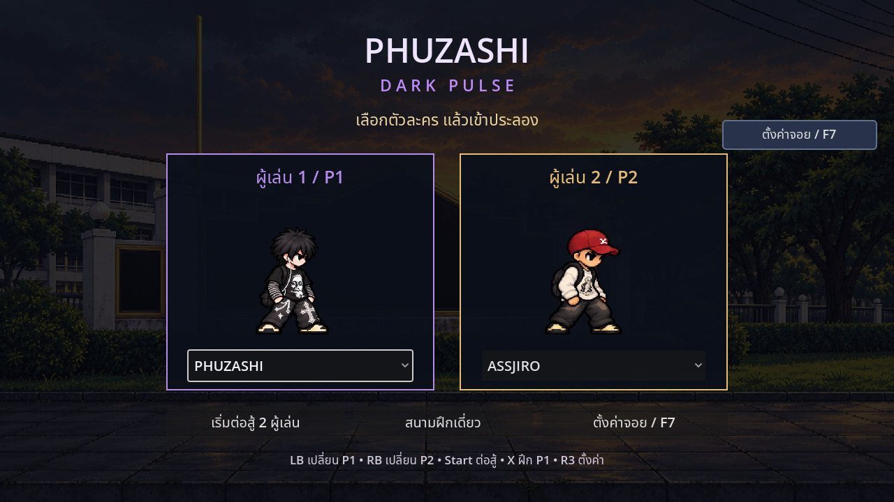
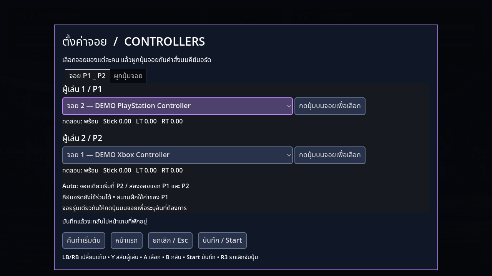

# รุ่นสามตัวละคร · ตั้งค่าจอย · ฟีโน่ · ตัวช่วยเชียร์

แตก ZIP → Godot4.2.2+ เลือก Import `project.godot` → F5 → เลือกตัวละครของ P1/P2 → เริ่มต่อสู้ หรือเข้าสนามฝึกด้วยตัวที่เลือกในช่องP1 รุ่นนี้ไม่มีEXEใหม่

## หน้าเข้าเกม

เลือกได้ทั้ง PHUZASHI, ASSJIRO และ MUAY THAI คนละช่อง ทั้งสองคนควบคุมคนละตัวตามจอย/คีย์บอร์ดที่ตั้งไว้

บนจอย: **LB/L1 เปลี่ยนตัว P1, RB/R1 เปลี่ยนตัว P2, Start/Options เริ่มต่อสู้สองผู้เล่น, X/Square เข้าสนามฝึก P1, R3 เปิดตั้งค่า** เมนูใช้ปุ่มมาตรฐานเหล่านี้ ส่วนปุ่มระหว่างต่อสู้ตั้งเองได้

F8 กลับหน้าเข้าเกม, F6 สลับสนามฝึก/ต่อสู้, Tab วนเลือกตัวละครในสนามฝึก

## ตั้งจอยและผูกปุ่มเอง

กด **F7**, กด **R3**, หรือคลิกปุ่ม “ตั้งค่าจอย” ได้จากหน้าเข้าเกมและในเกม เกมต่อสู้จะพักโดยเก็บ HP/MP/เวลา/คะแนนเดิม

1. แท็บ **จอย P1/P2** เลือก Auto, คีย์บอร์ดอย่างเดียว หรือจอยที่แสดงชื่ออยู่ ให้แต่ละผู้เล่นใช้คนละอัน
2. ใช้ “กดปุ่มบนจอยเพื่อเลือก” หากไม่แน่ใจว่าอันไหนเป็นจอย1/2 มีสถานะปุ่ม สติ๊ก และทริกเกอร์ให้ลองกดตรวจได้
3. แท็บ **ผูกปุ่มจอย** เลือก P1 หรือ P2 คลิกคำสั่งที่มีปุ่มคีย์บอร์ดกำกับ แล้วกดปุ่ม/ขยับแกนจอยที่จะใช้ เช่น **ต่อย / J → B / Circle**
4. ถ้าปุ่มนั้นมีคำสั่งเดิมอยู่ ระบบจะสลับสองคำสั่งให้ ไม่ให้ปุ่มเดียวทำสองท่าพร้อมกัน แกนสติ๊กและทริกเกอร์ผูกได้ด้วย โดยปล่อยกลับกลางก่อนจับค่า
5. กดบันทึก แล้วปล่อยปุ่ม/สติ๊กกลับกลาง กด Start/Esc เล่นต่อ ค่าที่บันทึกจะใช้เมื่อเปิดเกมครั้งถัดไป

ในหน้าตั้งค่า: **LB/RB เปลี่ยนแท็บ, Y สลับผู้เล่น, A เลือก, B ยกเลิก, Start บันทึก, R3 หรือ Esc ยกเลิกการจับปุ่ม** รายการคำสั่งเลื่อนตามโฟกัสได้ ปุ่ม R3 สงวนไว้เปิดตั้งค่าเพื่อกลับมาแก้ปุ่มได้เสมอ

“คืนค่าเริ่มต้น” ยังไม่เปลี่ยนค่าจริงจนกดบันทึก ยกเลิกเพื่อทิ้งการแก้ไขได้ และมีปุ่ม “หน้าแรก” กลับไปเลือกตัวละคร

Auto ยังใช้กติกาเดิม: จอยเดียวเป็นP2คู่กับคีย์บอร์ดP1; สองจอยแยกP1/P2 F5สลับจอยเดียวเมื่อใช้Auto หากตั้งเลือกจอยเองแล้ว F5จะเปิดหน้าตั้งค่าแทน สนามฝึกใช้การตั้งค่าของP1 คีย์บอร์ดยังใช้ร่วมกับจอยได้

ถอด/ต่อจอยแล้วเกมจะพัก จอยที่เลือกเองแต่ถูกถอดจะไม่ไปแย่งจอยอีกคน เมื่อเชื่อมต่อกลับจะหาเจ้าของจากชื่อ/ชนิดจอย จอยรุ่นเดียวกันที่สลับลำดับหลังเปิดเกมใหม่ใช้ปุ่มระบุจอยเพื่อเลือกอันที่ต้องการได้

ค่าจอยเก็บในข้อมูลผู้ใช้ของ Godot (`user://controllers.cfg`) ไม่ถูกใส่มาในZIPของเกม

## ปุ่มเริ่มต้นระหว่างต่อสู้

| คำสั่ง | P1 / สนามฝึก | P2 | จอย Xbox / PlayStation |
| --- | --- | --- | --- |
| เดิน | A/D | ←/→ | Stick / D-pad ซ้ายขวา |
| กระโดด | Space / W | ↑ | A / Cross |
| หมอบ | S | ↓ | Stick / D-pad ลง |
| วิ่ง | Shift | Ctrl | RB / R1 + ทิศทาง |
| ต่อย | J | Num1 หรือ comma | X / Square |
| เตะ | K | Num2 หรือ period | B / Circle |
| ป้องกัน | L | Num3 หรือ slash | LB / L1 |
| ชาร์จ7 MP/s | Q | P | LT / L2 |
| สกิลหลัก | U; Assjiro ใช้ I ได้ด้วย | Num4 หรือ apostrophe | RT / R2 |
| อัลติ | PHUZASHI I / Assjiro O | Num5 หรือ semicolon | Y / Triangle |
| หมอบ+ต่อย | S+J | ↓+ต่อย | ↓+X / Square |
| แดช / Blink | E หรือแตะทิศสองครั้ง | Num0 / backslash หรือแตะทิศสองครั้ง | L3 หรือแตะทิศสองครั้ง |
| ตัวช่วยเชียร์ PHUZASHI | T | [ | D-pad ขึ้น |
| พักเกม / รายการปุ่ม | Esc / F1 | เหมือนกัน | Start / Back |

ปุ่มตารางนี้เป็นค่าเริ่มต้น ดูค่าที่แก้เองในF7 ส่วนหน้าเข้าเกมและหน้าตั้งค่ายังใช้ปุ่มเมนูมาตรฐาน

## เลือด มานา และโล่

สนามต่อสู้เพิ่มเป็น **200 HP ต่อคน** ยังคง99วินาทีต่อยก ชนะครบ2ยก สนามฝึกใช้100HPเพื่อทดสอบท่าได้เร็ว

มานาเต็ม100 เริ่มยกที่100 ไม่มีฟื้นเอง ค้างชาร์จ7/s หมัด/เตะปกติโดนได้3 ท่าที่สามได้5 Perfect Guardได้3 ตีลม ติดการ์ด และสกิลโจมตีไม่ให้มานาคืน

ทุกตัวมีโล่โปร่งใสเมื่อกัน รับการโจมตีแล้วโล่กระพริบ ตัวสั่น มีเสียงกระแทก และถอยหลังเล็กน้อย Perfect Guardใช้แสงฟ้าและถอยน้อยกว่า การ์ดแตกมีเอฟเฟกต์แตก

GUARD100 ลดตามแรงโจมตี ปล่อยและไม่โดน1วินาทีฟื้น20/s การ์ดหมดเสียหลัก1วินาทีแล้วคืน50 Perfect Guardกดก่อนโดนภายใน0.12วินาที ไม่เสีย HP/GUARD หนึ่งครั้งต่อการกดป้องกัน แดชไม่สามารถป้องกันระหว่างพุ่งได้

## ASSJIRO

ชื่อใหม่ของตัวหมวกแดง รูปลักษณ์เดิม **ร่างใส่หมวกยังไม่มีหัวพุ่งหรือหมัดรัวแครอท** ใช้ท่าพื้นฐาน เดิน วิ่ง กระโดด หมอบ ต่อย เตะ กัน แดช และชาร์จได้

- แดช: พุ่งสั้นประมาณ97px ใน0.22วินาที คูลดาวน์0.45วินาที ไม่เสียมานา ไม่มีอมตะ ถูกสวน/ล็อกขัดได้
- อัลติ100MP: ถอดหมวก → เหยาะซอสขวดเหลือง → ถอดเสื้อ ใช้3.2วินาที ถูกขัดได้และไม่คืนมานา
- ร่างหัวโล้นรับความเสียหายลดลง **30% รวมดาเมจทะลุการ์ด** คิดHPเป็นทศนิยมเพื่อให้ลดตรง30% เกจป้องกันยังเสียตามปกติ
- เมื่อแปลงสำเร็จจึงใช้ **หัวพุ่ง25MP/22ดาเมจ** และ **หมัดรัว30MP/7ครั้งรวม32ดาเมจ** ได้ คงร่างจนจบยกหรือรีเซ็ต

## PHUZASHI

อัลติเดิมถูกแทนที่ด้วย **ขี่ฟีโน่สีม่วง–ดำพุ่งชน** ใช้60MP สร้าง60ดาเมจต่อเป้าหนึ่งครั้ง รถเคลื่อนที่จริง คู่ต่อสู้กัน/สวนได้ มีภาพใหม่16เฟรม มังกรและไฟล์เอฟเฟกต์มังกรเก่าถูกเอาออกจากรุ่นนี้

ท่าเดินเปลี่ยนเป็นภาพ8เฟรมที่สลับขาและแกว่งแขน ความคืบหน้าอนิเมชันอิงระยะที่เดินจริง รวมถึงเดินถอยหลัง ช่วยลดอาการไถล

**T / จอย D-pad ขึ้น: ตัวช่วยเชียร์** ใช้30MP คูลดาวน์14วินาที ตัวช่วยผมยาว เสื้อชมพู กระโปรงน้ำตาลจุดขาวและรองเท้าชมพูวิ่งเข้ามาเชียร์ เมื่อถึงจุดยืนให้บัฟ8วินาที:

- ปีศาจที่เรียกในช่วงบัฟล็อกได้ **1.1วินาที** แทน0.7วินาที
- เดินและวิ่งเร็วขึ้น10% กระโดด/Blink/ฟีโน่ไม่เพิ่มความเร็ว

ตัวช่วยไม่ใช่ตัวละครต่อสู้ให้เลือก ไม่มีการโจมตีหรือฮีล ไม่ให้บัฟซ้อน หมดเวลาแล้วกลับค่าปกติ รีเซ็ตหรือจบยกจะล้างตัวช่วยและบัฟ

## MUAY THAI

เพิ่มตัวละครนักมวยไทยตามภาพอ้างอิง เสื้อดำ นวมชมพู กางเกงมวยชมพูขอบขาวและเท้าเปล่า **สูงกว่าสองตัวเดิม20%** มี112เฟรมสำหรับเดิน วิ่ง กระโดด หมอบ กัน ต่อย เตะ โดนโจมตี ล้ม และคอมโบ พร้อมแดชและโจมตีกลางอากาศ

- **JJJ:** หมัดแย็บ → หมัดตรงหลัง → ศอก รวม36ดาเมจ
- **KKK:** ถีบ → เข่า → เตะสูง รวม52ดาเมจ
- ศอกกับเข่าใช้ระยะใกล้กว่าหมัดตรง/ถีบ มีภาพท่าจริงและจังหวะสัมผัสตรงกับช่วงสร้างดาเมจ
- ยังไม่มีสกิลพิเศษ อัลติ หรือตัวช่วยเชียร์ตามที่ขอ

## ภาพตัวอย่างและการทดสอบ

[ดูวิดีโอ](PHUZASHI_Roster_Update.mp4) · [ผลการทดสอบ](ROSTER_TEST_REPORT.md)

ภาพจอย DEMO ในเอกสารใช้ข้อมูลอุปกรณ์จำลอง ตัวเกมจริงแสดงชื่อจอยที่ Godot ตรวจพบ ทดสอบระบบจอยด้วยเหตุการณ์จำลองผ่านInputMapและหน้าต่างเกม ยังไม่มีการลองจอยจริงกับUSB/Bluetoothในสภาพแวดล้อมนี้
