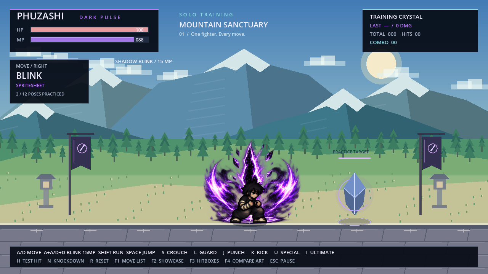

# PHUZASHI Shadow Blink / playable 12 frames

ตัวละครใช้ภาพเต็มตัวเดิมจาก `phuzashi_frames.res` เรียง Idle / Crouch / Run เป็นท่า Blink 12 เฟรม โดยไม่แก้หน้าตา ชุด หรือรองเท้า

แตะ **A สองครั้ง** หรือ **D สองครั้ง** ภายใน 280 ms เพื่อใช้ Shadow Blink ใช้ 15 MP พุ่ง 130 พิกเซลใน 0.4 วินาที คูลดาวน์ 0.5 วินาที ช่วงกลางท่าหลบความเสียหายได้

## เอฟเฟกต์ชุดที่ผู้ใช้เลือก

เพิ่มภาพเอฟเฟกต์ 16 เฟรมจาก `assets/effects/shadow_blink/shadow_blink_approved.png` ใช้ PNG ที่ผู้ใช้เลือกโดยตรง พื้นหลังโปร่งใสและไฟล์ต้นฉบับไม่ถูกแก้ไข

- เฟรม 1–6: รวมพลังและเปิดรอยแยก ยึดตำแหน่งเริ่มต้นไว้ขณะตัวละครเคลื่อนออกไป
- เฟรม 7–11: เส้นพลังและสายฟ้าพุ่งตามตัวละคร พร้อมเงาภาพเต็มตัว 3 ภาพที่ค่อย ๆ จาง
- เฟรม 12–16: รอยแยกปลายทาง วงระเบิด สะเก็ดพลังและควันที่จางหลังปรากฏตัว

สไปรต์ชีตมีช่องห่างไม่เท่ากัน จึงกำหนดขอบเขตและจุดยึดของแต่ละเฟรมแยกกันใน `scripts/effects/shadow_blink_vfx.gd` พร้อม shader ลดรอยขอบเอฟเฟกต์ รองรับการหันซ้าย–ขวา และยึดปลายทางตามขอบฉากจริง

เอฟเฟกต์ยาว 0.72 วินาทีเพื่อให้ควันจางหลังจบท่า ระยะพุ่ง ค่า MP คูลดาวน์และช่วงหลบความเสียหายยังใช้ค่าข้างต้นตามเดิม การกด Esc หยุดภาพเอฟเฟกต์ด้วย และ R ล้างเอฟเฟกต์กับเงาทั้งหมด

[วิดีโอจากเกมจริง: พุ่งขวาและซ้าย ความเร็ว 40% เพื่อดูรายละเอียด](PHUZASHI_Shadow_Blink_FX.mp4)

## เปิดเล่นชุดล่าสุด

ดาวน์โหลด [Godot ZIP พร้อมเอฟเฟกต์ Shadow Blink](downloads/PHUZASHI_Shadow_Blink_FX_Godot.zip) → แตก ZIP → เปิด Godot 4.2.2 ขึ้นไป → Import `project.godot` → F5

ชุดนี้เป็นโปรเจกต์ Godot ไม่ได้สร้างหรืออัปเดต EXE ส่วน ZIP Windows ที่อยู่ใน Repository เป็นรุ่นเก่า
