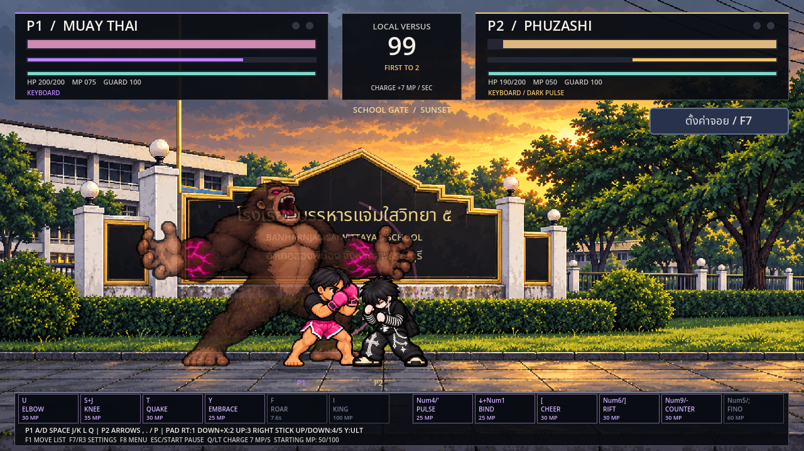
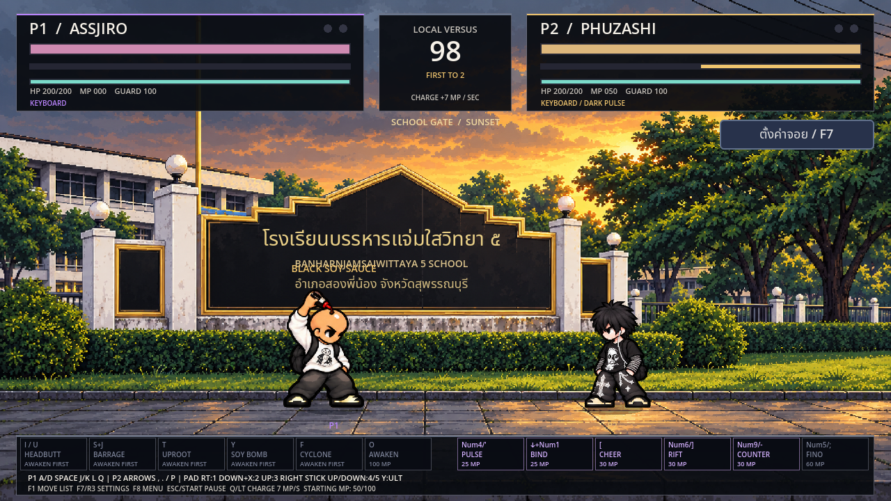

> คู่มือรุ่นก่อน: ปุ่มปัจจุบัน ค่าแปลงร่าง 70 MP และสกิลฟรีอยู่ที่ [CONTACT_UPDATE_TH.md](CONTACT_UPDATE_TH.md)

# สกิลตัวละ 6 ท่า · ซีอิ๊วดำ · เริ่ม 50 มานา

เปิดด้วย Godot 4.2.2 ขึ้นไป: แตก ZIP → Import `project.godot` → Import & Edit → รอนำเข้า → F5 เลือกตัวของ P1/P2 แล้วเริ่มต่อสู้ หรือเข้าฝึกด้วยตัวที่เลือกในช่อง P1

ทุกแมตช์ ทุกยก และการรีเซ็ตสนามฝึกเริ่ม **50/100 MP** ชาร์จ Q / P / LT เพิ่ม 7 MP ต่อวินาที ต่อยเตะเข้าเป้าได้ 3 MP ท่าปิดคอมโบได้ 5 MP สกิลและการตีติดการ์ดไม่ให้มานา

## ปุ่มสกิลทั้งสองผู้เล่น

| ช่อง | คีย์บอร์ด P1 / สนามฝึก | คีย์บอร์ด P2 | จอยแต่ละคน (ค่าเริ่มต้น) |
|---|---|---|---|
| 1 | U (ASSJIRO ใช้ I ได้ด้วย) | Num4 หรือ ' | RT / R2 |
| 2 | S + J | ลง + Num1 หรือ ลง + , | ลง + X / Square |
| 3 | T | [ | D-pad ขึ้น |
| 4 | Y | Num6 หรือ ] | สติ๊กขวาขึ้น |
| 5 | F | Num9 หรือ - | สติ๊กขวาลง |
| 6 อัลติ | I (ASSJIRO ใช้ O) | Num5 หรือ ; | Y / Triangle |

สติ๊กขวาใช้กดแล้วปล่อยกลับกลางเพื่อกดซ้ำ ไม่มีการรัวสกิลจากการค้าง ปรับปุ่มหรือแกนแต่ละฝั่งได้ใน F7 / R3 ค่าจอยที่เคยตั้งไว้จะคงอยู่และเพิ่มช่องใหม่ด้วยอินพุตที่ยังว่าง

## PHUZASHI

| ช่อง | ท่า | มานา | การทำงาน |
|---|---|---:|---|
| 1 | Dark Pulse | 25 | พัลส์ม่วงเดินทางไปด้านหน้า ดาเมจ 24 |
| 2 | Demon Bind | 25 | ปีศาจล็อก 0.7 วิ หรือ 1.1 วิเมื่อมีบัฟเชียร์ |
| 3 | Heart Support | 30 | ตัวช่วยหญิงวิ่งมาเชียร์ บัฟ 8 วิ เพิ่มเวลาล็อกและเดิน/วิ่งเร็ว 10% คูลดาวน์ 14 วิ |
| 4 | Dark Rift | 30 | วางรอยแยกห่างด้านหน้า 215px มีสัญญาณเตือน 0.48 วิ ก่อนระเบิด ดาเมจ 26 คูลดาวน์ 8 วิ กระโดดหลบได้ |
| 5 | Shadow Counter | 30 | ตั้งรับจังหวะสั้นช่วง 0.10–0.34 วิของท่า หากรับการโจมตีประชิดจากด้านหน้า เงาจะสวน 20 ดาเมจ คูลดาวน์ 8 วิ ไม่รับกระสุน และถูกสวนช่วงเก็บท่าได้ |
| 6 | Fino Dark Ride | 60 | ฟีโน่ม่วงดำพุ่งชนจริง ดาเมจ 60 ครั้งเดียว |

## ASSJIRO

ร่างใส่หมวกมีท่าพื้นฐาน แดช ป้องกัน ชาร์จ และอัลติแปลงร่าง **ต้องแปลงก่อนใช้ช่อง 1–5** เริ่ม 50 มานาจึงต้องสะสมให้ครบ 100 ก่อน ร่างหัวโล้นลดดาเมจที่ได้รับ 30% รวมชิปการ์ด คงร่างจนจบยก

| ช่อง | ท่า | มานา | การทำงาน |
|---|---|---:|---|
| 1 | Carrot Headbutt | 25 | กระโดดหัวพุ่งแนวนอน ออร่าแครอท ดาเมจ 22 |
| 2 | Carrot Barrage | 30 | หมัดรัว 7 จังหวะ รวม 32 ดาเมจ |
| 3 | Carrot Uproot | 30 | ย่อตัวแล้วหัวพุ่งขึ้น ออร่าแครอท ส่งร่างคู่ต่อสู้ลอยจริง ดาเมจ 24 คูลดาวน์ 7 วิ |
| 4 | Black Soy Bomb | 30 | ขว้างขวดซีอิ๊วสีดำเป็นวิถีโค้ง กระแทกตัวหรือพื้นแล้วแตก ดาเมจ 22 ต่อเป้าหมายหนึ่งครั้ง คูลดาวน์ 7 วิ |
| 5 | Carrot Cyclone | 35 | หมุนกวาดเตะรอบตัวระยะใกล้ ดาเมจ 30 ผลักออก คูลดาวน์ 9 วิ |
| 6 | Soy Awakening | 100 | ถอดหมวก → เหยาะซีอิ๊วดำจากขวดดำฝาแดง → ถอดเสื้อ ลำดับ 16 เฟรม ใช้เวลา 3.2 วิ โดนโจมตีขัดได้ |

ซอสทั้งในขวด เหยาะบนหัว และตอนแตกเป็น **ดำอมน้ำตาลเงาแบบซีอิ๊ว** ส่วนออร่าแครอทยังเป็นสีส้ม

## มวยไทย · สแตนด์กอริลล่าขนน้ำตาล

กอริลล่าขนน้ำตาลเข้ม อกและใบหน้าน้ำตาลอ่อน ตาและพลังชมพูม่วง ปรากฏหลังนักมวยเฉพาะตอนใช้สกิลหรือถือการ์ดที่มีบัฟ ขนาดประมาณ 1.5 เท่าของนักมวย มี 16 ภาพเต็มตัว แยกจากร่างนักมวย ไม่ใช่ตัวละครที่ควบคุมเพิ่ม

| ช่อง | ท่า | มานา | การทำงาน |
|---|---|---:|---|
| 1 | วานรศอกถล่ม | 30 | คนฟันศอก กอริลล่าทุบตาม ดาเมจ 30 คูลดาวน์ 7 วิ |
| 2 | เขี้ยววานรทะยาน | 35 | คนยกเข่า กอริลล่าเสยหมัด ส่งคู่ต่อสู้ลอย ดาเมจ 26 คูลดาวน์ 8 วิ |
| 3 | หมัดสะเทือนปฐพี | 30 | ทุบพื้นปล่อยคลื่นต่ำเดินทางจริง ดาเมจ 24 คูลดาวน์ 8 วิ กระโดดหรือกันได้ |
| 4 | อ้อมแขนวานร | 25 | บัฟ 4 วิ ขณะกันลดการเสียเกจการ์ด 45% ยังเสียชิปและการ์ดแตกได้ คูลดาวน์ 12 วิ |
| 5 | คำรามเจ้าป่า | 25 | คลื่นระยะใกล้ด้านหน้า ดาเมจ 10 เน้นผลักแยก คูลดาวน์ 8 วิ |
| 6 | ราชาวานรคลั่ง | 100 | เปิดด้วยเข่า หากโดนจึงต่อศอก/เข่าและหมัดกอริลล่า รวม 6 จังหวะ 60 ดาเมจ ปิดทุบพื้น คูลดาวน์ 18 วิ การ์ดหรือหลบจังหวะเปิดแล้วไม่โดนชุดต่ออัตโนมัติ |

ท่าตีลอยส่งตัวได้ครั้งเดียวก่อนเป้าหมายลงพื้นและฟื้นจากท่าโดนตี ป้องกันการเสยวนไม่จบ การใช้ท่าใหม่มีมานา คูลดาวน์ ช่วงเตรียมและเก็บท่า การถูกขัดก่อนปล่อยพลังไม่คืนมานา

## การเคลื่อนไหวและภาพ

เพิ่มภาพขว้างขวด/หมุนเตะ ASSJIRO 16 เฟรม แก้ซอสแปลงร่างครบ 16 เฟรม กอริลล่า 16 เฟรม และเอฟเฟกต์พลัง 16 เฟรม จุดวางเท้าและทิศทางยึดกับตัวจริง จังหวะกอริลล่าทุบ/เสยตรงกับหน้าต่างดาเมจ เพิ่มการหยุดภาพกระแทกสั้น ๆ เสียงแรงกระแทก และกล้องสั่นเฉพาะฉาก HUD ไม่สั่น

[วิดีโอครบ 18 ท่า](PHUZASHI_Six_Skills.mp4) ใช้การเติมมานาในสคริปต์สาธิตเพื่อให้ดูท่าได้ต่อเนื่อง เกมจริงเปิดที่ 50 มานาตามภาพแรก

ดู [ผลทดสอบ](SIX_SKILLS_TEST_REPORT.md) และใช้ `bash tools/check.sh` ตรวจซ้ำ ไฟล์ดาวน์โหลดเป็นซอร์ส Godot ไม่มี EXE ใหม่
