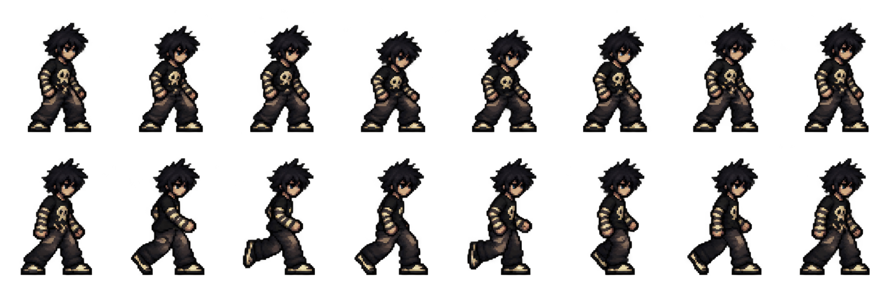

# แผนเปลี่ยนจาก mesh เป็น spritesheet

ผู้ใช้รายงานว่ารูปร่างยังดูขาด/บิดหลังแก้การเคลื่อนไหว จึงเปลี่ยนแนวทางงานอาร์ตเป็นเฟรมแอนิเมชันเต็มตัว วาดแต่ละ pose ให้ร่างกายต่อเนื่อง แล้วจึงนำเข้า AnimatedSprite2D/SpriteFrames ใน Godot การเชื่อม mesh อย่างเดียวไม่แก้คุณภาพรูปร่างของภาพเฟรมเดียว

## ภาพร่างรอบแรก

ภาพนี้เป็น **ร่างแนวทาง 8 ท่ายืน + 8 ท่าเดิน** จาก Master ต้นฉบับ สร้างด้วยเครื่องมือ image generation ยังไม่ผ่านการตรวจความตรงของใบหน้า ผม ชุด ลายกะโหลก และรองเท้าทุกเฟรม ไม่ถือเป็นภาพต้นฉบับที่ได้รับอนุมัติหรือ asset พร้อมใช้งาน

ไฟล์ร่างมีขนาดจริง 2172×724 ซึ่งยังไม่ตรงกริดเป้าหมาย จึงเก็บใต้ docs/ ที่มี .gdignore ไม่ให้ Godot นำเข้าหรือเลือกใช้แทนตัวละครจริงในฉากฝึก ไม่เปลี่ยน renderer ในเกมจากร่างนี้

## ข้อกำหนด atlas ที่จะใช้จริง

- ใช้ `assets/characters/PHUZASHI_MASTER_SHOES_APPROVED.png` เป็นแบบอ้างอิงหลัก ห้ามออกแบบหน้าตา ชุด หรือรองเท้าใหม่
- แต่ละเฟรม 128×128 px พื้นหลังโปร่งใส โดยตัวละครมีขนาดประมาณเดิม 52–54 px ก่อนขยายแสดงผล ไม่ขยายรายละเอียดคนละสเกลในแต่ละเฟรม
- Pivot ที่ (64,112) เส้นเท้าขณะยืนอยู่ที่ y=112; พื้นที่ว่างรอบตัวรองรับท่าเตะและท่าล้ม
- 8 เฟรมต่อท่า จัด 8 คอลัมน์; atlas รวม 12 แถวขนาด 1024×1536 px
- ลำดับแถว: IDLE, WALK, RUN, JUMP, CROUCH, GUARD, PUNCH, KICK, HIT, FALL, SPECIAL, ULTIMATE
- ทุกเฟรมหันขวา ใช้ flip_h สำหรับหันซ้าย
- แยกเอฟเฟกต์พลัง/มังกรออกจากภาพตัวละคร เพื่อรักษาหน้าตาและขนาดตัวละคร
- แต่ละภาพเป็น pose เต็มตัวที่ต่อเนื่องทางกายวิภาค ไม่แยกหมุนชิ้นแขนขาเพื่อใช้แทนเฟรม

## ลำดับตรวจคุณภาพ

1. ล็อกรูปลักษณ์กับ Master และทำ IDLE/WALK ให้รายละเอียดและสัดส่วนตรงกันก่อนผลิตท่าต่อสู้ทั้งหมด
2. ตรวจภาพนิ่งทุกเฟรมและเล่น loop: ศีรษะไม่เปลี่ยนรูป เสื้อ/ลายกะโหลกไม่เปลี่ยน รองเท้าเหมือนเดิม แขนขาไม่ขาด และเท้าไม่ลอย/จม
3. ทำ RUN/JUMP/CROUCH/GUARD และท่าต่อสู้ตามกริดเดียวกัน
4. นำ atlas ที่ตรวจแล้วเข้า AnimatedSprite2D/SpriteFrames แทน mesh; ผูกระยะ startup/active/recovery ให้ตรงกับระบบต่อสู้เดิม
5. ทดสอบการเคลื่อนไหว การกลับด้าน การสัมผัสพื้น และทุกท่าจากภาพเรนเดอร์จริงใน Godot

Master ยังคงเดิมทุกไบต์ SHA-256:
`d0d6156d5114d612c1d04e39781fcd5c783eb09b0ba1268fc8b42c9779e6be06`
