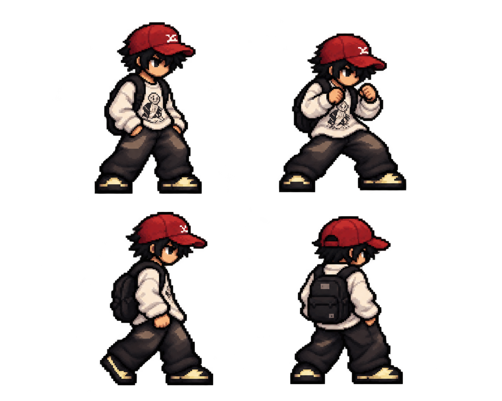

# แบบร่างตัวละครจากภาพถ่าย

แบบล่าสุดปรับให้เป็นพิกเซลอาร์ตหัวโต ตัวกะทัดรัด ตาแบบอนิเมะ แขนขาสั้น
กางเกงทรงหลวมและรองเท้าทรงเดียวกับตัวละคร PHUZASHI ตัวแรก
ใช้หมวกแก๊ปสีแดง เสื้อแขนยาวขาวลายดำ กางเกงดำ และกระเป๋าดำจากภาพต้นทาง
เป็นแนวทางของชุด ลาย และสี

ภาพพื้นหลังโปร่งใสมี 4 มุม/ท่า: ยืนสามส่วน ตั้งการ์ด ด้านข้าง และด้านหลัง
เพื่อใช้ตรวจแบบก่อนสร้างท่าเคลื่อนไหว ภาพนี้เป็นเอกสารออกแบบ
ไฟล์เกมทดสอบ Demon Bind ใช้ตัวละคร PHUZASHI และคริสตัลฝึกที่มีอยู่ตามเดิม

[แบบก่อนหน้าสำหรับอ้างอิงชุดและสีจากภาพถ่าย](concept.png)

ภาพถ่ายต้นทางไม่ได้ถูกคัดลอกเข้า Repository
