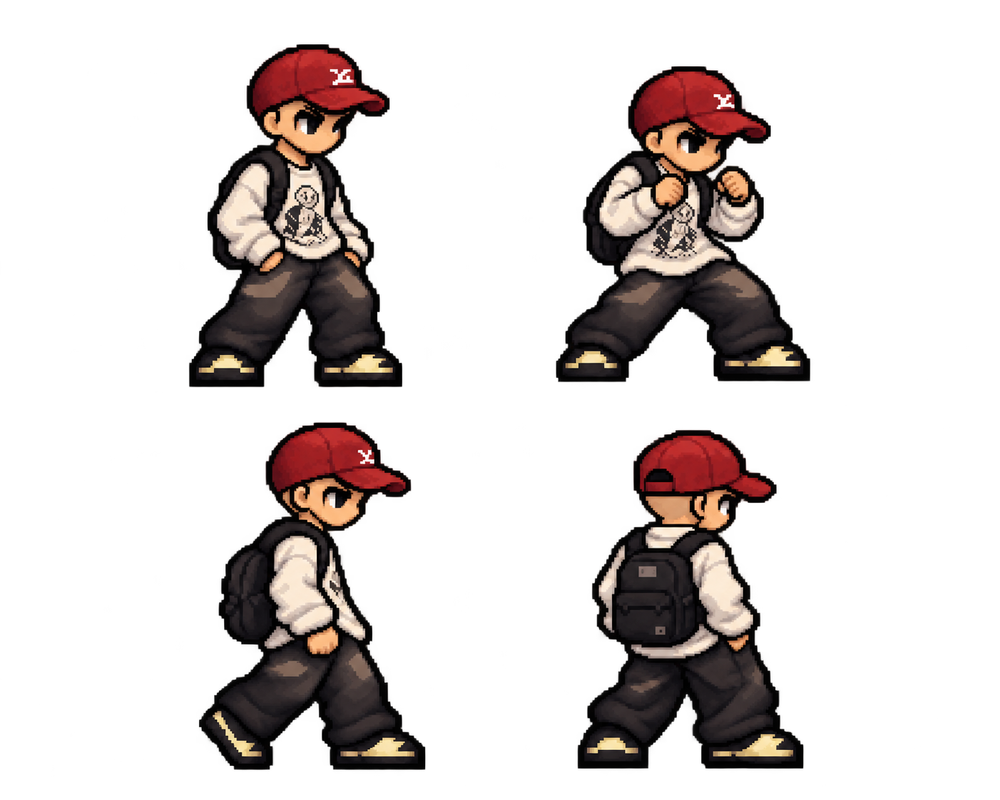

# แบบร่างตัวละครจากภาพถ่าย

แบบล่าสุดปรับให้เป็นพิกเซลอาร์ตหัวโต ตัวกะทัดรัด ตาแบบอนิเมะ แขนขาสั้น
กางเกงทรงหลวมและรองเท้าทรงเดียวกับตัวละคร PHUZASHI ตัวแรก
ใช้หมวกแก๊ปสีแดง เสื้อแขนยาวขาวลายดำ กางเกงดำ และกระเป๋าดำจากภาพต้นทาง
เป็นแนวทางของชุด ลาย และสี

ภาพพื้นหลังโปร่งใสมี 4 มุม/ท่า: ยืนสามส่วน ตั้งการ์ด ด้านข้าง และด้านหลัง
เพื่อใช้ตรวจแบบก่อนสร้างท่าเคลื่อนไหว ภาพนี้เป็นเอกสารออกแบบ
แบบปัจจุบันตัดผมที่โผล่ใต้หมวกออกทั้งหมดแล้ว และนำไปสร้างท่าปกติ 112 เฟรม เปิดเกมรุ่น Red Cap แล้วกด Tab สลับมาทดสอบได้

[ท่าปกติและวิธีเล่น](../../../RED_CAP_NORMAL_MOVES_TH.md) · [แบบก่อนแก้ผม](concept_chibi.png)

[แบบก่อนหน้าสำหรับอ้างอิงชุดและสีจากภาพถ่าย](concept.png)

ภาพถ่ายต้นทางไม่ได้ถูกคัดลอกเข้า Repository
