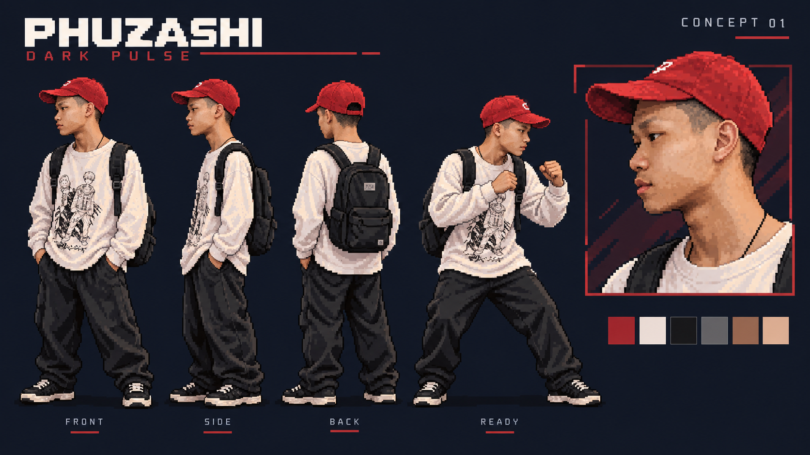

# แบบร่างตัวละครจากภาพถ่าย

ออกแบบเป็นพิกเซลอาร์ตโดยอ้างอิงคนในภาพที่ผู้ใช้ส่งมา ยึดหมวกแก๊ปสีแดง
ผมสั้น เสื้อแขนยาวสีขาวลายเส้น กางเกงดำ สายคล้องคอ และกระเป๋าสะพายสีดำ
เป็นลักษณะหลัก มีภาพเต็มตัว มุมด้านข้าง มุมหลัง ท่าตั้งการ์ด และภาพใบหน้าขยาย
เพื่อใช้ตรวจแบบก่อนสร้างท่าเคลื่อนไหว

ภาพต้นทางไม่เห็นรองเท้า จึงเลือกสนีกเกอร์ดำพื้นอ่อนให้เข้ากับชุดในแบบร่าง
ภาพนี้เป็นเอกสารออกแบบแยกจากตัวละคร PHUZASHI ที่เล่นอยู่ในเกม
ไฟล์เกมทดสอบ Demon Bind ใช้ตัวละครและคริสตัลฝึกที่มีอยู่ตามเดิม

ภาพถ่ายต้นทางไม่ได้ถูกคัดลอกเข้า Repository
