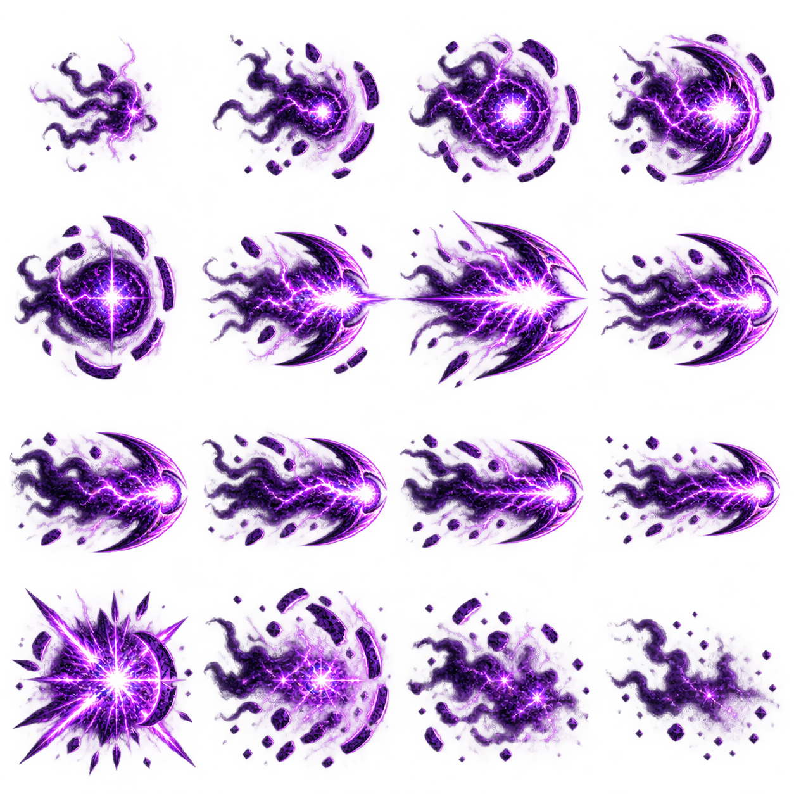
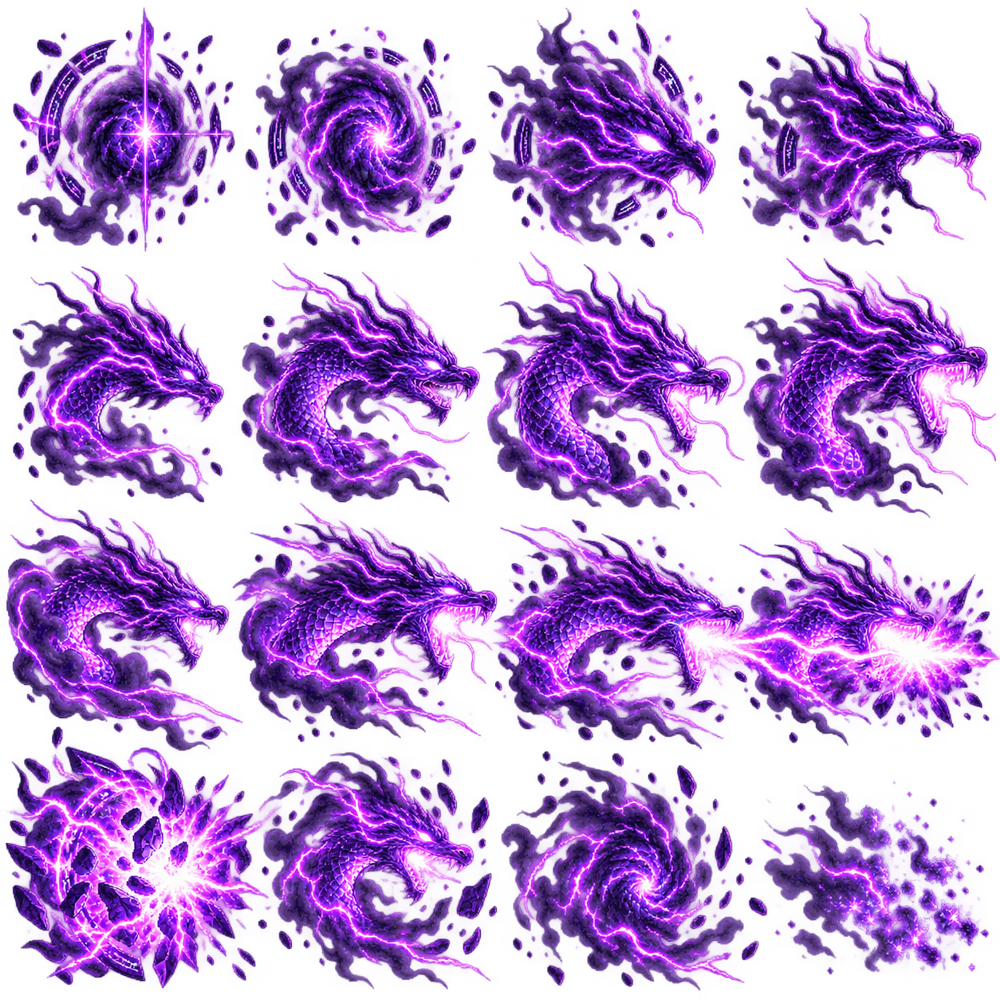

# ร่าง spritesheet เอฟเฟกต์พลัง / สำหรับดูรูปแบบก่อนนำเข้าเกม

ผู้ใช้ขอ spritesheet เอฟเฟกต์ที่มีรายละเอียดมากขึ้นก่อนแก้ runtime จึงจัดทำภาพร่างสองชุด ชุดละ 16 ช่อง รวม 32 ช่อง อ่านซ้ายไปขวา บนลงล่าง

## Dark Pulse

- แถว 1: รวมและชาร์จพลัง
- แถว 2: บีบอัดแกนและปล่อยกระสุนเสี้ยวพระจันทร์
- แถว 3: กระสุนเคลื่อนที่ พร้อมสายฟ้าและหางพลัง
- แถว 4: ปะทะ แตกกระจาย และสลายเป็นควัน

## Violet Dragon / Ultimate

- แถว 1: วงเวทและหัวมังกรเริ่มปรากฏ
- แถว 2: หัว เกล็ด เขา และเขี้ยวชัดขึ้น
- แถว 3: มังกรพุ่ง/คำรามและปล่อยพลังไปทางขวา
- แถว 4: พลังระเบิดและมังกรสลาย

ทั้งสองภาพใช้พลังม่วง/แมเจนตา แกนสว่าง สายฟ้า เกล็ด/เศษวงเวท และควัน พื้นหลัง RGBA โปร่งใส แยกจากภาพตัวละคร

ภาพนี้เป็นงานออกแบบสำหรับดูรูปแบบ ยังไม่ใช่ atlas ที่ตรวจ alignment/loop ผ่านแล้ว ต้องจัดระยะขอบ จุดอ้างอิง และการแยกเฟรม โดยเฉพาะ glow ที่เข้าใกล้ช่องข้างเคียง ก่อนทำ animation ใน Godot

ยังไม่ได้เปลี่ยน spritesheet ตัวละคร โค้ด VFX ระบบการเล่น หรือไฟล์เกม Windows จากร่างชุดนี้
